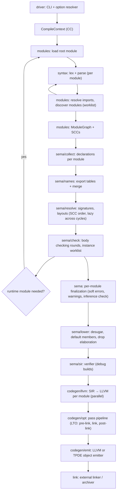

# Compiler re-implementation plan

This document plans a complete re-implementation of the Spice compiler (`src/`). The goal is a compiler that is easier to
keep correct and to extend: clear components, one place for each semantic decision, and no hidden coupling between
stages. Compile performance must stay at least as good as today. The new compiler must keep all existing tests green and
keep all existing functionality.

It is a re-architecture that ports the existing behavior, not a clean-room rewrite. The test suite pins exact error
texts, warning orders and LLVM IR text (see [the test contract](#31-the-test-contract)). So the rules are moved into new
components, but the order in which they run, and the output they produce, are kept.

## Table of contents

1. [Summary](#1-summary)
2. [Current state](#2-current-state)
3. [Constraints](#3-constraints)
4. [Target architecture](#4-target-architecture)
5. [Components in detail](#5-components-in-detail)
6. [Cross-cutting concerns](#6-cross-cutting-concerns)
7. [Use of Spice language features](#7-use-of-spice-language-features)
8. [Keeping the tests green](#8-keeping-the-tests-green)
9. [Migration plan](#9-migration-plan)
10. [Work packages for AI agents](#10-work-packages-for-ai-agents)
11. [Risks and mitigations](#11-risks-and-mitigations)
12. [Alternatives considered](#12-alternatives-considered)
13. [Decisions](#13-decisions)
14. [Appendix A: legacy to new mapping](#appendix-a-legacy-to-new-mapping)
15. [Appendix B: SIR node catalog](#appendix-b-sir-node-catalog)
16. [Appendix C: glossary](#appendix-c-glossary)

## 1. Summary

The compiler is 51,297 lines of Spice in 92 files. Most of its complexity comes from five structural decisions, not
from individual bugs:

1. **Semantic results are stored on the AST.**
   - Every expression node has a vector of types, indexed by the generic manifestation (`manIdx`, 283 uses).
   - About 25 more per-manifestation vectors (`FctCallData`, `DeclStmtData`, cleanup lists, …) are filled by the type
     checker and read by the IR generator.
2. **Generic instantiation copies scopes.**
   - Every manifestation deep-copies its scope subtree.
   - The copies hold pointers that have to be patched up afterwards.
   - Type identity includes a `Scope*`, so copying a scope creates new types.
3. **Type checking is a fixpoint.**
   - A prepare and a check mode are followed by whole-file re-visits, which repeat until no file requests another one.
   - Import cycles are handled by guard flags and a global sweep instead of an SCC computation.
4. **Semantic decisions are split between the type checker and the IR generator.** The IR generator re-runs overload
   resolution, decides copy vs. move vs. memcpy, and re-derives conversions and cleanups. Operator rules exist twice
   (`op-rule-manager.spice` and `op-rule-conversion-manager.spice`), and default-member bodies exist twice.
5. **There are no layers.** The directory import graph is cyclic (`ast` ↔ `typechecker`, `symboltablebuilder` ↔
   `irgenerator`, `model` ↔ `irgenerator`, …). Two god objects (`SourceFile`, `GlobalResourceManager`) and ten
   process-wide `ACTIVE_*` singletons connect everything.

The plan fixes the five root causes like this:

| Root cause                     | Replacement                                                                                                                                                               |
|--------------------------------|---------------------------------------------------------------------------------------------------------------------------------------------------------------------------|
| Semantic state on the AST      | An immutable AST. Semantic results live in the **Spice IR (SIR)**, a typed intermediate representation with one body per function instance.                                                 |
| Scope copies per manifestation | **Instances** `(DeclId, [TypeId])` with substitutions. Lexical scopes are built while checking an instance body.                                                          |
| Pre/post fixpoint, re-visits   | **Demand-driven instantiation** with a deterministic, round-based worklist. Each body is checked exactly once.                                                            |
| Decisions split sema/IRG       | **All** semantic decisions are made in sema and written into the SIR as explicit nodes. Codegen is a mechanical SIR → LLVM lowering. Operator rules come from one table. |
| No layers, global state        | **Eight layers** with an enforced dependency DAG. One `CompileContext` (CC) object is passed explicitly, with no singletons.                                                  |

The migration builds the new compiler in `src-next/`, next to the legacy compiler in `src/`, which stays the production
compiler until cutover. A **differential harness** compares both compilers on every test case, the whole std and the
compiler sources. Each phase has an exit gate that is measured by the existing test suite. A **ratchet** prevents
regressions of test cases that already pass.

Everything a user observes stays the same: program behavior, diagnostics, IR, assembly, formatter and linter output.
Dumps of compiler internals (AST, symbol table, type registry, …) follow the new data model, and their refs change. The
open GitHub issues are fixed directly in the new compiler, not in the legacy one. Cutover happens when the complete test
suite, the bootstrap fixed point and the performance budget are green for the new compiler.

## 2. Current state

### 2.1 Size and hot spots

| File                                             |  Lines | Notes                                                                    |
|--------------------------------------------------|-------:|--------------------------------------------------------------------------|
| `typechecker/type-checker.spice`                 |  8,165 | one struct; Spice requires all methods of a struct in the struct's file  |
| `irgenerator/ir-generator.spice`                 |  7,847 | one struct, same reason                                                  |
| `ast/ast-nodes.spice`                            |  3,948 | 78 node kinds, plus constant folding and control-flow analysis           |
| `parser/parser.spice`                            |  2,939 | also allocates type ids, evaluates literals, registers strings           |
| `source-file.spice`                              |  1,991 | pipeline driver, import graph node, name registry, LLVM state, dumps     |
| `driver.spice`                                   |  1,763 | CLI declaration, option resolution, run-binary, 13 unit tests            |
| `typechecker/op-rule-manager.spice`              |  1,547 | operator rule tables (rebuilt per `TypeChecker` instance)                |
| `symboltablebuilder/qual-type.spice`             |  1,372 | type API that also triggers instantiation and lowers to LLVM             |
| `irgenerator/op-rule-conversion-manager.spice`   |  1,298 | the same operator rules again, as `isComb` chains                        |

- There are 2,091 functions. 47 of them have 100 or more lines and 9 have 200 or more. The longest are
  `OpRuleManager.initRules` (494 lines), `TypeChecker.visitFctCall` (349) and `IRGenerator.visitFctCall` (347).
- 578 functions return `Any`, which heap-boxes every non-trivial visit result.
- `cliOptions.` is used 603 times in 16 files. Every pass can read every option.
- `abortWithError` (print and `exit`) has 42 call sites, some of them on back-end worker threads.

### 2.2 Root causes in detail

**R1: semantic state on the AST.** Passes write these annotations onto AST nodes:

- `symbolTypes[manIdx]`, plus `data[manIdx]` of `FctCallData`, `VarAccessData`, `DeclStmtData`, `ReturnStmtData`,
  `TernaryExprData`, `ForeachLoopData` and `ErrPropagationData`.
- Per-call and per-operator data: `argInfos`, `opFct[manIdx][opIdx]`, `lhsDtorFct` and `rhsMoveCtor`.
- Cleanup and instantiation data: `resourcesToCleanup`, `instantiatedStructs`, `fieldCopyCtors` and `returnedLocals`.
- Control-flow and layout flags: `compileThenBranch`, `unreachable`, `coversAllEnumItems`, `emitVTable` and
  `actualSize`.

Even the parser adds type ids, compile-time values and attribute targets. `customItemsInitialization` allocates
per-manifestation slots for 20 node kinds. The AST file imports 14 middle-end modules. The same node is shared by all
manifestations, so the semantic state of one instance is reached through a mutable cursor (`CompilerPass.manIdx`). The
IR generator even overwrites `manIdx` temporarily for field default values.

**R2: instantiation by scope copy.**

- `Scope.copyChildScope` and `deepCopyScope` copy symbols, captures, registries and children for every function, struct,
  interface and union manifestation, and for every optional-parameter arity.
- The copied `SymbolTableEntry.scope`, `Function.bodyScope` and `declNode` pointers stay stale until the managers patch
  them.
- `CompilerPass.changeToScope` rewrites `scope.parent` on every scope entry, so the shape of the scope graph depends on
  time. It is also a latent data race in the parallel back end.
- `bodyScope` is part of type identity, so a struct type before and after manifestation are different `Type*`.

**R3: the fixpoint type checker.**

- PRE runs bottom-up over the dependencies and POST runs top-down. POST repeats whole-file visits while
  `reVisitRequested` is set. Five call sites set the flag, including any lookup cache miss in `matchFunction`.
- The loop has no iteration cap.
- Struct manifestations are re-checked on every re-visit.
- Cycles are handled by the guards `typeCheckerPreRunning` and `typeCheckerPostRunning`, the `dependsOn` BFS over path
  strings, the `haveAllDependantsBeenTypeChecked` gate and a global sweep.
- Runtime modules are loaded in the middle of type checking. They change the source file list while the sweep iterates
  over it.

**R4: the back end re-derives semantics.** The IR generator itself does the following (line numbers in
`ir-generator.spice`):

- It re-runs overload resolution for ctors, copy ctors and dtors (`lookupFunction`, e.g. :1114, :2262-2290, :6585,
  :6793, :6884, :7009, :7083).
- It decides the semantics of struct assignment (:942-1175) and raises `COPY_CTOR_REQUIRED` from the back end (:1124).
- It re-matches arguments to parameters and chooses conversions (:4448, :4586-4640, :6102, :6179-6224).
- It builds cleanup paths for jumps by walking AST parents (:6399-6440).
- It desugars foreach (:2533-2725) and lowers `Result`/error propagation (:4237-4296).
- It decides linkage, vtable layouts and thunks.

Unreachability is tracked twice: `stmt.unreachable` in the type checker and `blockAlreadyTerminated` in the IR
generator. A bug fix in copy, move or dtor semantics regularly has to touch both stages. That pattern runs through many
of the recent fixes.

**R5: duplicated rules.**

- Operator typing is written twice, in two different encodings.
- The question "are these types equal or compatible" has about ten partial implementations:
  - `TypeChainElement ==`, `Type.matches`, `QualType ==` and `QualType.matches`;
  - `haveSameBodyScopes`, `GenericType.checkTypeConditionOf` and `type-matcher.spice`;
  - the function, struct, interface and union managers.
- There are two inconsistent `hashQualType` functions.
- Runtime function signatures exist in three places: the std source, type checker name lists and
  `std-function-manager.spice`.
- The function prologue is copy-pasted four times (main, function, lambda, implicit function).
- `struct-`, `interface-` and `union-manager.spice` are near clones.

**R6: no layering.**

- Cycles exist between `ast`, `symboltablebuilder`, `typechecker`, `model`, `irgenerator` and `global`.
- `Type.toLLVMType` lives in the type model and imports name mangling and `SourceFile`.
- `QualType.getStruct` calls the struct manager, so a getter can trigger instantiation.
- `sizeof` in the type checker needs LLVM's data layout.
- `SourceFile` combines six roles. `GlobalResourceManager` owns allocators, caches, timers, the linker, the error
  manager and freestanding hooks, and installs the `ACTIVE_*` singletons. So there can be only one compilation per
  process: the formatter creates and destroys a full resource manager, including LLVM initialization, for each file.

**R7: errors terminate the process.** Lexer and parser errors call `exit()`. Semantic errors are recorded on a global
error manager. These are the rules that the new compiler has to keep:

- Only the first hard error is kept.
- Soft errors are deduplicated by code location and flushed as one `UNRESOLVED_SOFT_ERRORS` block.

But the mechanism prevents reuse by a language server or by unit tests, and prevents error recovery.

**R8: performance smells.** These are fixed by design in the new compiler:

- `Any` boxing on every visit.
- String keys on hot paths, for example `"fct:" + codeLoc`, signature-keyed manifestation maps and `"struct:Name"`
  scope names.
- A builtin dispatch that compares strings.
- Operator tables that are rebuilt for each checker, and a scan of all files for operator overloads.
- An O(n) `orderIndex` loop per symbol insert.
- Error snippets that re-read the source file from disk.
- An LLVM context, builder and target machine created for every source file, even for lint.
- A second copy of the source text in the `Reader`.
- One heap-allocated `children` vector per AST node.

### 2.3 What works and is kept

- The **hand-written lexer and recursive descent parser**, including their accepted language and their error messages.
  The speculative lookahead rules are kept, so that exactly the same programs parse.
- **Hash-consed types** (`TypeRegistry`), **block allocation** (`BlockAllocator`), and the **ordered maps** where order
  is visible in the output.
- The **parallel back end** and its determinism rules (`media/specs/parallel-backend.md`), including the serial linker
  input order.
- The **diagnostic catalog**: the `SemanticErrorType` codes (128), the warning kinds (22), the message prefixes and
  the rendering format.
- The **test runner** (`test/run-tests.py`), which uses the compiler as a black-box process. The
  **benchmark suite** (`benchmark/run-benchmarks.py run --compiler NAME=PATH …`) can already compare several compilers.
- The **package-based LLVM and TPDE bindings** (`src/spice.toml`).

## 3. Constraints

### 3.1 The test contract

There are 1,029 reference test cases in 11 suites, plus 67 builtin `#[test]` unit tests in 19 files under `src/`.
`run-tests.py` compares these artifacts:

| Reference                                      | Count               | Comparison                                                                                   | What it pins                                                                                                                                                                        |
|------------------------------------------------|--------------------:|----------------------------------------------------------------------------------------------|-------------------------------------------------------------------------------------------------------------------------------------------------------------------------------------|
| `cout.out`                                     | 514                 | exact stdout of the compiled program                                                         | behavior                                                                                                                                                                           |
| `exception.out`                                | 417                 | exact text from the first `[Error\|` header                                                  | error codes, prefixes, messages, code snippet and marker, **which error is reported first**                                                                                         |
| `ir-code*.ll` (O0 to Oz, OS and arch variants) | ~290 files, 31.9k lines | exact text after removing ` dso_local ` and `!DIFile` lines (debug cases); x86_64 hosts only | value and block names (e.g. `cond.true.L6C14`), instruction and alloca order, function and declaration order, globals (`@anon.string.N`), attribute groups, metadata numbering |
| `exit-code.out`                                | 36                  | exact                                                                                        | behavior                                                                                                                                                                           |
| `warning.out`                                  | 24                  | exact, ordered, main file only                                                               | warning texts and order                                                                                                                                                             |
| `assembly-*.asm`                               | 16                  | exact, not on GitHub Actions                                                                 | back end and target                                                                                                                                                                 |
| `syntax-tree.dot`                              | 9                   | exact                                                                                        | node kinds, child order, node ids `L<line>C<col>_<Kind>`                                                                                                                            |
| `symbol-table.json`                            | 9                   | exact                                                                                        | scope tree incl. expression scopes (`expr:L19C20`), symbol order and states                                                                                                         |
| `type-registry.out`                            | 7                   | exact                                                                                        | the set of interned types (sorted names)                                                                                                                                            |
| `format.out`                                   | 7                   | exact, plus idempotence                                                                      | formatter                                                                                                                                                                           |
| `lint.out`                                     | 4                   | exact, exit code                                                                             | linter                                                                                                                                                                              |
| `debug.out`                                    | 4                   | GDB transcript (local only)                                                                  | debug info                                                                                                                                                                          |
| `dependency-graph.dot`                         | 2                   | exact                                                                                        | module graph traversal                                                                                                                                                              |
| `cache-stats.out`                              | 1                   | exact                                                                                        | lookup-cache hit and miss counters, i.e. the cache implementation                                                                                                                   |

There are more checks on top of the reference files:

- Every case must run through all stages without a crash or a sanitizer report.
- 121 cases set flags in a `// TEST:` header (`--target`, `--freestanding`, `--backend=tpde`, `-lto`, `-g`, …).
- CI runs Linux x86_64 and aarch64, Windows x86_64 and macOS aarch64, then `bootstrap.py`. The bootstrap requires a
  bit-identical fixed point, so the compiler must be deterministic.
- ASAN, coverage, nightly benchmarks and the docs examples check (`tools/check_doc_examples.py`) run as separate
  workflows.

**What this means for the rewrite:**

- **About 260 cases only pass with byte-identical LLVM IR.** The new codegen must reproduce the legacy lowering
  recipes: names, order and attributes (see [8.3](#83-byte-identical-ir)).
- **417 cases pin the diagnostic order.** "First hard error wins" and the soft-error blocks mean that the new checker
  must visit constructs in the legacy order and bail out at the same points.
- The **white-box dumps** (`syntax-tree.dot`, `symbol-table.json`, `type-registry.out`, `dependency-graph.dot`,
  `cache-stats.out`, 28 cases) serialize compiler internals. They are **allowed to change** (decision
  [D2](#13-decisions)). The new compiler dumps its own data model, and these refs get new versions (see
  [8.6](#86-white-box-dumps)).
- The 67 builtin unit tests call internal APIs (`Driver`, `SourceFile`, `GlobalResourceManager`, …). They are
  **ported** to the equivalent new APIs, test by test (see [8.5](#85-builtin-unit-tests)). They cannot run unchanged
  against code that no longer exists.

### 3.2 Constraints from Spice as the implementation language

The compiler is self-hosted and built by the pinned stage0 compiler (`.github/stage0-version`). It is bumped from 0.30.1
to 0.30.2 in [#1887](https://github.com/spicelang/spice/pull/1887) (decision [D3](#13-decisions)). That leads to these constraints:

| Constraint                                                                                             | Consequence for the design                                                                                                                                                                 |
|--------------------------------------------------------------------------------------------------------|---------------------------------------------------------------------------------------------------------------------------------------------------------------------------------------------|
| All methods of a struct have to live in the file of the struct                                         | No big structs. Each component is several small structs, one per file, plus free functions. They share state through explicit context structs. File budget: about 1,200 lines.           |
| A type has to be declared before use within a file (no forward declarations); cycles across files work | One struct per file. Reference across layers by **integer ids**, not by pointers to types of another layer. This breaks import cycles.                                                    |
| Globals can only be primitives                                                                         | No singletons. Everything hangs off an explicitly passed `CompileContext`.                                                                                                                 |
| Pointers cannot be hashed                                                                              | Dense **integer ids** and id-indexed vectors instead of `UnorderedMap<long, …>` keyed by addresses.                                                                                         |
| No exceptions                                                                                          | `Result<T>` for operations that can fail (IO, module loading, linking), and a `DiagnosticEngine` for compile errors. Only the driver exits.                                                |
| No virtual dispatch through plain structs                                                              | `switch` over node kinds on hot paths. Interfaces where pluggability is needed (emitters, sinks, observers).                                                                                |
| Lambdas cannot safely capture state                                                                    | Callbacks are small structs that implement an interface.                                                                                                                                    |
| Default methods of generic interfaces are not supported                                                | Generic interfaces have no default methods. Default traversal is on non-generic visitor interfaces.                                                                                         |
| `<` cannot be overloaded, no static methods                                                            | Explicit `compare` functions for sorting. Free functions for constructors of ids.                                                                                                          |
| Reference fields must be bound from a variable                                                         | Prefer pointers or ids for long-lived context fields.                                                                                                                                       |
| Members of a type that a generic from another module instantiates have to be `public` (spike, WP 1.1)  | Element types of `Vector<T>`, `IdVec<T>` and friends get `public` ctors, dtors and members, also in `impl/` directories. A non-`public` member is not exported, and linking the instance fails.      |
| Only stage0 features are available                                                                     | Stage0 0.30.2 supports `T&&` and `move` ([#1881](https://github.com/spicelang/spice/pull/1881)) and parameter names in interface signatures ([#1864](https://github.com/spicelang/spice/pull/1864)). Newer language features need another stage0 bump. See [decision D3](#13-decisions).                    |
| The bootstrap requires a fixed point                                                                   | No output can depend on pointer values or hash-map iteration order. Iteration order comes from ids or ordered containers.                                                                  |
| LLVM C API limits                                                                                      | No `dso_local`, no moving of instructions (allocas are hoisted by inserting at a marker), no `createMethod` debug info, no module summary. These stay as they are.                         |

### 3.3 Properties of the Spice language that the design exploits

| Language property                                                                                  | Design consequence                                                                                                                                                                                |
|----------------------------------------------------------------------------------------------------|---------------------------------------------------------------------------------------------------------------------------------------------------------------------------------------------------|
| Structs, interfaces, unions, enums, aliases, generic types, functions and globals exist only at module level. Methods are defined outside the struct (`p Car.drive()`). | One declaration pass per module collects everything without looking at bodies. It can run in parallel per module.                                                                                 |
| Every function, procedure and method has explicit parameter and return types (`f<T>`, `p`).          | Checking a body only needs **signatures**, never another body. So each body is checked independently and exactly once. There is no global fixpoint.                                              |
| Inference is local: `dyn` declarations, inline lambda result expressions.                            | Inference stays inside one body. There is no cross-function constraint solving.                                                                                                                  |
| Generics are monomorphized. Template lists are explicit, constraints are lists of types (`type T int\|long`). | An instance is the key `(DeclId, [TypeId])` in a memo table. Constraints are checked when an instance is created.                                                                                |
| Type names are lexically distinct (capitalized `TYPE_IDENTIFIER`).                                   | The parser keeps telling declarations from expressions with cheap token probes.                                                                                                                  |
| Control flow is structured: no `goto`; `break`, `continue`, `fallthrough` and `return` are structured exits. | Definite initialization, move state and drop elaboration run on a **structured** SIR. No CFG is needed, and the legacy block structure and block names are preserved for free.                   |
| The compiled language has no exceptions.                                                            | No unwind paths or landing pads. Cleanups only run on structured exits, and functions stay `nounwind`.                                                                                           |
| Interfaces are used only through pointers and references. Vtables exist per (struct, interface).     | Vtable layout is computed once, when a struct instance is resolved.                                                                                                                              |
| Union fields are trivially copyable.                                                                 | No lifetime handling inside unions, only tag checks.                                                                                                                                             |
| Imports are explicit at the top of a file. Cycles only exist between declarations.                   | The module graph is known before semantic analysis. SCCs matter only for signature resolution, not for body checking.                                                                            |
| Operators are overloaded only through named functions (`op.plus`, …).                                | Operator resolution is a lookup in the primitive rule table, followed by an overload lookup by a fixed name in an index built once.                                                             |
| `unsafe` is a lexical block.                                                                         | "Unsafe allowed" is a flag of the checking context.                                                                                                                                              |
| Visibility is per file (`public`).                                                                   | One export table per module, built once.                                                                                                                                                         |

## 4. Target architecture

### 4.1 Design principles

- **P1: one decision, one place.** Every semantic decision is made exactly once, in sema, and recorded explicitly. This
  covers overload choice, conversions, copy/move/drop, cleanups, vtable slots and linkage. Later stages consume these
  decisions and never re-derive them.
- **P2: immutable artifacts per stage.** A stage produces an artifact, for example tokens, the AST, declarations,
  instances, SIR, an LLVM module or an object file. Later stages only read it. No stage writes into the artifact of an
  earlier stage.
- **P3: ids, not pointers or strings.**
  - Cross-component references are dense 32-bit ids: `FileId`, `ModuleId`, `NodeId`, `Symbol`, `TypeId`, `DeclId`,
    `InstanceId`, `LocalId` and `SirId`.
  - Identifiers and names are interned once.
  - Strings are only built for output: diagnostics, mangling and dumps.
- **P4: explicit context, no global state.** All state hangs off one `CompileContext` (CC). Several compile contexts per
  process are possible, which the formatter, language-server and test use cases need.
- **P5: small structs, one responsibility per file.** About 1,200 lines per file at most, and about 150 lines per
  function at most. Both are checked in CI as warnings.
- **P6: diagnostics are data.** Components report `Diagnostic` values to a sink. Rendering and the decision to stop
  belong to the driver. The rendered text is byte-identical to the legacy text.
- **P7: layers are a DAG, enforced in CI.** A component imports only components of lower layers, and only through
  their façade files.
- **P8: observable outputs stay, internals may change.** Everything a user observes stays identical: program behavior,
  diagnostics, IR, assembly, formatter and linter output. Dumps of compiler internals follow the new data model (D2).
  The core data model never bends to the legacy dumps.
- **P9: port behavior, re-home structure.** The order of checks, the bail-out points and the lowering recipes are
  ported from the legacy code. The structure around them is new.

### 4.2 Pipeline



Dumps (`--dump-ast`, `--dump-symtab`, `--dump-types`, `--dump-ir`, …) and stage timers are **observers** of the stage
artifacts. They are not code inside the stages.

### 4.3 Layers and components

The final layout after cutover is shown below. During the migration the same tree lives in `src-next/`.

```
src/
├── main.spice                 entry point: constructs the driver, nothing else
├── base/          L0  arena, interner, ids, id-indexed vectors, hashing, small containers, timer, concurrency,
│                      process/file-system helpers, manifest (spice.toml) reader
├── source/        L1  SourceManager (FileId → buffer + line table), Span, location formatting, snippet extraction
├── diag/          L1  Diagnostic, DiagnosticEngine (policies), renderers, message catalogs (generated)
├── syntax/        L2  token, lexer, ast (generated), parser/*, literal decoding, IAstVisitor, AST dot printer
├── modules/       L3  import resolution (pure), module loader, ModuleGraph (SCC, orders), module attributes,
│                      runtime module catalog
├── sema/          L4
│   ├── types/         TypeStore (interned), QualType, type printer, TypeRelations, ITargetLayout (interface)
│   ├── model/         declarations (FunctionDecl, StructDecl, …) and instances (FunctionInstance, …)
│   ├── names/         module scope, member tables, lexical scopes, export tables, lookup
│   ├── collect/       declaration collector (per module)
│   ├── resolve/       type expression resolver, signature resolver, struct layouts, cycle handling
│   ├── ops/           operator + conversion rule table (generated) and queries
│   ├── overload/      candidate index, argument matching, scoring, generic inference
│   ├── instantiate/   instance memo tables + round-based worklist
│   ├── consteval/     ConstValue + folding
│   ├── members/       implicit default members, interface conformance, vtable layout, union checks
│   ├── lifetime/      init/move state tracker, escaping-reference checks, temporaries
│   ├── check/         body checker: statements, expressions, calls, builtins, inline asm, lambdas, switch
│   ├── lower/         SIR → SIR passes: foreach/`!`/Result desugaring, default member bodies, drop elaboration
│   ├── sir/           SIR nodes (generated), builder, printer (`--dump-sir`), verifier
│   ├── warnings/      unused-symbol and other warnings
│   └── dump/          symbol table, type registry and cache statistics dumps (white-box, see 8.6)
├── codegen/       L5
│   ├── target/        TargetInfo, data layout (implements ITargetLayout)
│   ├── abi/           call signature lowering (sret, coercion), per target
│   ├── mangle/        Itanium-style name mangling of instances
│   ├── llvm/          CodegenUnit, type lowering, function/expr/stmt/call/builtin/op emitters, cleanups,
│   │                  vtables + thunks, lambdas, runtime declarations, test main, debug info, metadata
│   ├── opt/           pass pipelines, sanitizers, coverage, LTO
│   └── emit/          IObjectEmitter, LLVM emitter, TPDE emitter
├── link/          L6  linker command builders per platform (pure), external linker runner, archiver, bitcode linker
├── tools/         L7  format/, lint/ (rules), viz/ (dependency graph dot)
└── driver/        L8  cli/, options/ (resolver), context/, pipeline/ (scheduler), commands/ (build, run, test, lint,
                       format, install, uninstall), stats/, progress/
```

**Allowed dependencies:** each layer may import any lower layer. Imports within a layer go through the
sub-component's façade. The exceptions are listed in this table:

| Component             | May import                                                                                                                                                                                      |
|-----------------------|--------------------------------------------------------------------------------------------------------------------------------------------------------------------------------------------------|
| `base`                | std and packages                                                                                                                                                                                 |
| `source`, `diag`      | `base`; `diag` also `source`                                                                                                                                                                      |
| `syntax`              | `base`, `source`, `diag`                                                                                                                                                                          |
| `modules`             | + `syntax`                                                                                                                                                                                       |
| `sema/*`              | + `modules`. Internal order: `types` → `model` → `names` → `collect`/`resolve` → `ops`/`overload`/`instantiate`/`consteval` → `members`/`lifetime` → `check` → `lower`; `sir` is used from `check` onwards; `dump` and `warnings` read everything. |
| `codegen/*`           | `sema/types`, `sema/model`, `sema/sir` (read-only), lower layers. **Never** `sema/check`, `sema/overload`, `sema/instantiate`.                                                                       |
| `link`                | `base`, `diag`, `codegen/target`                                                                                                                                                                  |
| `tools/format`        | `syntax` only                                                                                                                                                                                    |
| `tools/lint`, `tools/viz` | `syntax`, `modules`, read-only sema views                                                                                                                                                    |
| `driver`              | everything                                                                                                                                                                                       |

The table lives in `tools/check_layering.py`. That script checks every `import "@/…"` line and fails CI on a
violation. The file and function size budgets (10.2) are reported as warnings.

The script reads the points the table leaves open like this:

- Components of the same tier of the sema order (`collect`/`resolve`, `ops`/`overload`/`instantiate`/`consteval`,
  `members`/`lifetime`) may import each other, and the `codegen/*` components may import each other.
- `tools/format` may import `syntax` and the layers below it. `tools/lint` and `tools/viz` may additionally import
  `modules` and the read-only sema views `sema/types`, `sema/model`, `sema/names` and `sema/sir`.
- `sema/sir` may import `sema/types` and `sema/model`. Only `sema/check`, `sema/lower`, `sema/dump`, `sema/warnings`
  and `codegen/*` may import it.
- Imports from `@/spice_packages/` count like std imports in every layer, `base` included (decision of WP 1.2c: `base/manifest` uses the
  `manifest` package). Files directly in `src-next/` belong to the driver layer.
- The façade rule is not checked.

### 4.4 Core data model

**Ids and storage.**

- Every id is a single-field struct (for example `type TypeId struct { unsigned int index }`), so the type checker
  catches mixed-up ids. Phantom-typed generics would avoid one struct per id kind. Whether stage0 supports them is
  checked in a spike in phase 1.
- `IdVec<T>` is a dense vector indexed by an id.
- `Arena<T>` is the typed successor of `BlockAllocator`.
- `Interner` maps strings to `Symbol` ids. All maps on hot paths are keyed by ids.

**Source.**

- `SourceManager` reads each file once and keeps a line-start table.
- `Span { FileId file; unsigned int start; unsigned int stop }` is 12 bytes. It replaces the 40-byte `CodeLoc`, which is
  copied into every token and node.
- Line and column are computed on demand.
- Formatting helpers reproduce the legacy strings: `L<line>C<col>`, pretty paths, the snippet with a `^^^` marker.

**AST (syntax only).**

- The 78 node kinds of today stay, including the precedence-level expression nodes with operand and operator lists.
  The language does not change, and the formatter depends on the kinds. `syntax-tree.dot` is expected to stay the
  same, but as a white-box dump it is allowed to change (D2).
- Every node has a header `{kind, NodeId id, Span span, NodeId parent}`, typed child fields, and a child range into a
  per-module child array instead of a heap-allocated `children` vector.
- No semantic fields. Literal values, type ids, attribute evaluation, string registration and scope pointers are
  removed from the parser and the nodes. The parser keeps only syntactic facts, for example "this data type is in a
  parameter position", which the formatter and checker need.
- `NodeId` is dense per module and assigned in creation order. That replaces the global `nodeToNodeId` hash map.
  Sorting by `(ModuleId, NodeId)` reproduces the legacy parse order where order is visible (anonymous symbol order,
  dtor order).
- Node definitions are **generated** from `syntax/ast/ast.def`: kind enum, structs, `accept`, child iteration, kind
  names, visitor interface with defaults, and the destruct switch. Adding a node kind then means editing one
  definition, not twelve places (see [6.6](#66-code-generation-of-boilerplate)).

**Types (`sema/types`).**

- `TypeStore` interns structural keys and returns `TypeId`. The type kinds are:
  - `Prim(kind)`, `Ptr(TypeId)`, `Ref(TypeId, rvalue)`, `Array(TypeId, size)`;
  - `Fn(ret, params, hasCaptures)`;
  - `Struct(StructInstanceId)`, `Interface(InterfaceInstanceId)`, `Union(UnionInstanceId)`, `Enum(DeclId)`;
  - `Generic(GenericParamId)`, plus `Dyn`, `Invalid` and `Unresolved`.
- Identity is integer equality. No `Scope*` is part of identity: nominal types are identified by their instance.
- `QualType { TypeId type; QualifierBits quals }` is 8 bytes. The seven bools of `TypeQualifiers` become one bitset
  with a single implementation of merge and hash.
- Derived properties are cached per `TypeId`: base type, "contains generics", "trivially copyable", "trivially
  destructible" (the last two are filled by `sema/members`).
- `TypeRelations` is the **single** module for identity, convertibility (`convertible(from, to, mode)`) and generic
  unification (`unify(candidate, requested, mapping)`). It replaces the ten partial implementations listed in R5.
- Size, alignment and field offsets (`sizeof`, `alignof`, `offsetof`) are asked through `ITargetLayout`. That interface
  is implemented by `codegen/target` and passed into sema by the driver. So sema needs no LLVM module.

**Declarations and instances (`sema/model`).**

- Declarations are immutable after collection:
  - `FunctionDecl` (name, owner type, template params, params with optional flags, return type expression, attributes,
    AST node), `StructDecl`, `InterfaceDecl`, `UnionDecl`, `EnumDecl`, `AliasDecl`, `GlobalVarDecl`, `ExtDecl` and
    `GenericParamDecl`.
- Instances are created on demand and keyed by `(DeclId, [TypeId])`:
  - `FunctionInstance`: substituted signature, mangled name (lazy), flags (`used`, `virtual`, vtable slot, attributes)
    and `SirBodyId`.
  - `StructInstance`: field types, the method table, implemented interface instances, vtable layout and default
    members.
  - `InterfaceInstance` and `UnionInstance`.
- An optional-parameter arity is a separate `FunctionInstance` of the same declaration, as it is today, but without
  copying a scope.
- Each declaration keeps its instances in creation order (`Vector<InstanceId>`). Codegen emits them in this order
  (see [8.3](#83-byte-identical-ir)).
- Mutable analysis results are kept in side tables owned by sema, not in the declarations. Examples are `used` flags,
  lifecycle state and capture access types. The side tables are frozen before the back end, which then only reads
  them.

**Names (`sema/names`).**

- The module scope holds one entry per top-level name, `Symbol → DeclId`.
- Member tables per struct, interface, union and enum declaration map `Symbol → member`.
- `ExportTable` per module.
- The `NameRegistry` of a module is its own names plus the merged imports. It keeps the legacy rules:
  - each imported name is registered as `import::name` and as `name`;
  - a bare name that two imports expose becomes ambiguous and is recorded for the error message;
  - the module's own names win.
- It is built once, in dependency order, as a sorted flat table.
- Lexical scopes for locals are created **while checking an instance body**. They live with that body's SIR, not in a
  global scope tree.
- Captures are recorded explicitly by the lambda checker, not as a side effect of lookup.

**Spice IR (SIR, `sema/sir`).**

- There is one `SirBody` per function instance, global initializer and field default value. Nodes are allocated in a
  per-module arena.
- The SIR is **structured**: it mirrors the syntax of statements, so the LLVM block structure and names stay the same.
  But every implicit operation is explicit:
  - resolved callees (`InstanceId`), virtual call slots, conversions with a kind;
  - copy, move and drop operations with their instance;
  - temporaries with their destruction points, cleanups attached to scope exits and jumps;
  - folded constants, pruned branches, union tag checks, error propagation and lifetime markers.
- Each node carries the `Span` of its AST origin. Debug locations, block names and diagnostics come from it.
- See [Appendix B](#appendix-b-sir-node-catalog) for the node set.

### 4.5 Ownership and lifetimes

```
CompileContext, CC (driver/context)        lives for one compilation
├── ResolvedOptions                         immutable slices: FrontendOptions, SemaOptions, CodegenOptions,
│                                           LinkOptions, DumpOptions, ToolOptions
├── SourceManager, Interner                 append-only
├── DiagnosticEngine                        collects, applies policies, renders through the driver
├── ModuleGraph                             Module[ModuleId]: path, flags, attributes, AST arena, deps, exports
├── SemaContext                             TypeStore, decl/instance tables, name registries, rule tables,
│                                           lookup caches, SIR arenas per module, side tables
├── BackendContext                          TargetInfo; CodegenUnit per module (LLVM context/module/builder/
│                                           target machine created lazily when the back end starts)
├── Linker
└── observers                               StageTimers, StatsCollector, ProgressReporter, DumpSinks
```

- AST arenas live until the end of sema. They can be released earlier once the dumps have run, and the
  formatter frees them per file.
- A SIR arena is freed after its codegen unit is emitted. That keeps peak memory close to today's, even with many
  instances.
- LLVM resources are created when the back end starts, so `lint`, `format` and sema-only runs never initialize them.

## 5. Components in detail

Each component description lists what it is responsible for, its main types, the legacy code it replaces, and any notes
that matter for compatibility or performance. A complete file mapping is in
[Appendix A](#appendix-a-legacy-to-new-mapping).

### 5.1 `base`

- **Responsibility.** Infrastructure that knows nothing about the compiler:
  - `Arena<T>`;
  - `Interner` (open addressing, `Symbol` ids, stable `const char*` views);
  - `IdVec<T>` and `SmallVec`;
  - `hashMix`, `hashPointer` and the `combineHashes` of the std; maps keyed by an id use `IdMap`;
  - `ConditionalLock` and `ParallelSection` (kept as they are);
  - `Timer`, process execution, file system helpers, the `spice.toml` reader.
- **Replaces.** `util/block-allocator`, `util/memory`, `util/custom-hash-functions`, `util/lookup-cache` (the generic
  part), `util/concurrency`, `util/system-util`, `util/manifest`, `util/save-and-restore` and `util/common-util`.
- **Notes.** `unsafe` is confined to `base` and the LLVM glue in `codegen/llvm`. Micro-benchmarks for the interner and
  the arena run as `#[test]` functions with timing output.

### 5.2 `source`

- **Responsibility.** `SourceManager` (reads a file or a string once, line-start table, UTF-8 aware column computation
  as in `Reader`), `Span`, the location formatters used by diagnostics, dumps and block names, and snippet extraction.
- **Replaces.** `reader/reader.spice`, `reader/code-loc.spice` and `ASTNode.getErrorMessage`. The snippet is now cut
  from the cached buffer instead of re-reading the file.
- **Notes.** The legacy pretty path depends on the global `ROOT_SOURCE_FILE_PATH`. It becomes a field of the
  `SourceManager`, set by the driver.

### 5.3 `diag`

- **Responsibility.**
  - `Diagnostic { Severity, Family, code, Span, message, withSnippet }`, where `Family` is one of Lexer, Parser,
    Semantic, Compiler, Linker, Cli, Warning or Lint. Two more fields carry what legacy kept in the class of a diagnostic: `soft` (semantic errors) and `rule`
    (lint findings, which have the rule id where the others have the prefix).
  - `IDiagnosticSink`.
  - `DiagnosticEngine`, which implements the legacy policies:
    - lexer, parser, CLI and compiler errors are fatal;
    - for semantic errors the first hard error wins;
    - soft errors are deduplicated by span start;
    - soft errors are flushed per module at checkpoints into one `UNRESOLVED_SOFT_ERRORS` block;
    - warnings are deduplicated per module.
  - Renderers for the exact legacy texts (`[Error|Semantic] <loc>:\n<prefix>: <message>\n\n<snippet>`, the colored
    `[Warning]` lines, lint findings).
- **Catalogs.** `SemanticErrorType`, `ParserErrorType`, `CompilerErrorType`, `CliErrorType`, `LinkerErrorType`,
  `LexerErrorType` and `CompilerWarningType`, with their prefixes, are generated from `diag/diagnostics.def`.
- **Replaces.** `exception/*`, `util/compiler-warning.spice`, and the soft/hard logic in `SourceFile`.
- **Notes.** Nothing calls `exit()` except `driver/main`. A component that hits a fatal error reports it and returns
  `Result` errors upwards, or a poisoned value. The pipeline stops at the next checkpoint. That is the point where the
  legacy compiler aborted, so the output is the same.

### 5.4 `syntax`

- **Lexer.**
  - Works on the `SourceManager` buffer. A token is `{TokenType kind, Span span}`; the text is sliced on demand, there
    is no `String` per token.
  - Keyword lookup uses a switch on the length followed by a comparison, as today.
  - Comments stay in a side array of trivia tokens for the formatter. The parser reads the comment-free index, as
    today.
  - `>>` and `<<` keep their legacy treatment: the parser splits them. The splitting moves into one helper,
    `TokenCursor`.
- **Parser.**
  - The same grammar functions, split by area into separate structs and files that share a `ParserState` struct (one
    struct per file is the language constraint): `decl-parser`, `stmt-parser`, `expr-parser`, `type-parser`,
    `attr-parser`, `lookahead` (the speculative `is…Ahead` probes, unchanged).
  - The 14 binary precedence functions become one precedence-table-driven loop. It builds the same node kinds with the
    same operand and operator lists, so the AST stays identical.
  - Literal decoding (numbers with range checks, char and string escapes) moves into `syntax/literal`. That module is
    called by sema, which turns literals into `ConstValue`s. The legacy parser reports some literal errors as parser
    errors, for example "base prefix without digits". Those checks stay in the parser so that the error family and
    timing stay the same.
  - The parser returns `ParseResult { AstModule, Vector<Diagnostic> }`. In legacy mode the driver stops on the first
    error, which reproduces today's output. Error recovery is a later, opt-in improvement.
- **AST.** Generated nodes (see [4.4](#44-core-data-model)), `IAstVisitor` (a non-generic interface with a
  default-traversal method per node, used by tools), `forEachChild`, and the AST dot printer (`ASTVisualizer`). Its output is
  expected to stay the same, because the node kinds stay, but it may change (D2).
- **Replaces.** `lexer/*`, `parser/*`, `ast/*`, and the parse-time parts of `GlobalResourceManager` (`astNodeAlloc`,
  `nodeToNodeId`, `compileTimeStringValues`, `getNextCustomTypeId`).
- **Notes.**
  - Type ids are no longer assigned by the parser. `sema/collect` assigns them in the legacy order. Legacy ids start at
    256 and follow parse order across files, and the `core.compiler.fixedTypeId` attribute is applied the same way.
  - Removing `children` vectors and `Any` makes parsing cheaper. The target is at least 1.3× the legacy parse
    throughput.

### 5.5 `modules`

- **Responsibility.**
  - `resolveImport(importPath, importer, roots) → Result<ResolvedImport>`. It is pure and unit-tested with a fake file
    system (`IFileSystem`). It covers the `std/`, `@/` and relative roots, the "no `..`" rule, symlink containment with
    the `spice_packages` exception, and platform and architecture suffixes.
  - The module loader (dedup by canonical path).
  - `ModuleGraph` with ordered dependency lists, dependants, Tarjan SCCs computed once, and the legacy traversal orders
    (front end, PRE, POST and back end, see [8.4](#84-diagnostic-and-warning-order)).
  - Module attributes (`core.compiler.alwaysKeepSymbolsOnNameCollision`, `ignoreWarnings`, `requiresOs`, …).
  - The runtime module catalog: which type and function names need which `std/runtime/*_rt` module. It is data,
    not string lists spread over the type checker.
- **Replaces.** `importcollector/*`, the graph parts of `SourceFile` (`dependencies`, `dependants`, `dependsOn`, the
  guard flags), and `global/runtime-module-manager.spice`.
- **Notes.** Runtime modules are still requested lazily by sema, because the set of loaded modules is visible in the IR
  and in the dependency graph. A request runs the loader, the parser, `collect` and `names` for the new module. The new
  module is appended to the graph in a defined position, the same as in legacy.

### 5.6 `sema/types`, `sema/model`, `sema/names`

- These are described in [4.4](#44-core-data-model). They replace `symboltablebuilder/{type, type-chain, qual-type,
  type-qualifiers, super-type, symbol-table, symbol-table-entry, scope, scope-handle, capture, lifecycle}`,
  `global/type-registry`, `global/type-name-disambiguator`, `model/*`, and the name registry parts of `SourceFile`.
- `TypeNameDisambiguator` becomes a deterministic pass: all type names are claimed once, ranked by type id, after
  collection. That also removes the known non-determinism noted in `parallel-backend.md`.

### 5.7 `sema/collect` and `sema/resolve`

- **Collect.** One declaration collector per module. It registers every top-level declaration in the module scope and
  the export table, checks duplicates and redeclarations, and processes attributes. It assigns type ids, mirroring the
  legacy parser order. It replaces `SymbolTableBuilder` and the declaration half of PRE (`prepareFctOrProcDef`,
  `visitStructDefPrepare`, …).
- **Resolve.**
  - The type expression resolver turns AST data types into `QualType`s. It covers modifiers, qualifiers, array sizes
    from const globals, aliases and generic coverage. It replaces `visitDataType`, `visitBaseDataType` and
    `visitCustomDataType`.
  - The signature resolver computes the parameter and return types of every function declaration, the field types of
    every struct declaration, and generic constraints.
  - Resolution is lazy and memoized. An import cycle that references a struct before it is resolved gets an opaque
    type on demand, as `assignDeferredOpaqueType` does today. Its fields are filled in when its resolution completes.
    Resolution of by-value struct recursion through fields reports the legacy error.
- **Order.** Signatures are resolved in the legacy PRE order: dependencies first, source order within a module. Errors
  found while resolving are reported in the same order as before.

### 5.8 `sema/ops`, `sema/overload`, `sema/instantiate`, `sema/consteval`

- **ops.** One rule table, `ops.def`, generated into Spice. Each row has this shape:
  `operator × lhs kind × rhs kind → result kind, LoweringKind, flags (needs unsafe, signedness fix-up, …)`.
  - The checker uses the result kind and flags.
  - The SIR stores an `OpRuleId`.
  - Codegen switches over the `LoweringKind`: int add, FP add, pointer GEP, int compare signed or unsigned, FP
    compare, string compare, cast int to FP, …
  - The table is built once per process. It replaces `typechecker/op-rule-manager.spice` and the `isComb` chains of
    `irgenerator/op-rule-conversion-manager.spice`.
  - Operator overload lookup uses an index `opName → [FunctionDeclId]` that is built after collection. It replaces the
    scan over all source files.
- **overload.**
  - The candidate index `(owner, Symbol) → [FunctionDeclId]` replaces the linear scan over `scope.functions`.
  - Argument matching goes through `TypeRelations`. Specificity scoring is ported as it is: +1 constify, +100 const
    loss, +1000 implicit upcast, the rvalue-ref preference, and non-generic beats generic.
  - Binding rejections become hard errors only if nothing matches, as today.
  - The lookup cache is keyed by a **verified** key `(owner, name, this type, args with temporary flags, template
    hints, strictness)`: the hash is checked with full key equality, which fixes the hash-only cache and the missing
    `strictQualifierMatching` component.
  - It replaces `function-manager`, `struct-manager`, `interface-manager`, `union-manager` (one generic
    `NominalTypeMatcher`) and `type-matcher`.
- **instantiate.**
  - `instantiateFunction(decl, typeArgs)` and `instantiateStruct/Interface/Union(decl, typeArgs)` return an
    `InstanceId` immediately. They are memoized, and they enqueue new function bodies on the worklist.
  - **Round-based worklist.** Bodies are checked in rounds that mirror the legacy re-visit loop. Round *n* processes
    every pending instance, ordered by (module in legacy POST order, declaration in source order, instance creation
    order). Instances discovered in round *n* are checked in round *n + 1*. This reproduces the legacy creation order
    of manifestations, which determines the IR emission order, without whole-file re-visits.
  - Runtime module requests and the struct default-member decisions run at the legacy points within a round.
  - It replaces `reVisitRequested`, `alreadyTypeChecked`, `isNewlyInserted`, `STRUCT_DEFAULT_MEMBERS_DECIDABLE`, the
    dependants gate and the global sweep.
- **consteval.**
  - `ConstValue` is a **tagged union** (`int`, `short`, `long`, `byte`, `char`, `bool`, `double`, string id). It comes
    with explicit conversion functions for the cross-member reads the legacy code relies on, for example the long value
    of an int constant.
  - Folding, division-by-zero checks, `if` pruning, `sizeof`/`alignof`/`offsetof` (through `ITargetLayout`), and
    const-global references.
  - It replaces `ASTNode.hasCompileTimeValue` and `getCompileTimeValue`, `CompileTimeValue`, and
    `compileTimeStringValues`.

### 5.9 `sema/members`, `sema/lifetime`

- **members.**
  - Decides which implicit ctor, copy ctor, move ctor and dtor a struct instance gets, with the legacy timing rules:
    the deferred decisions and the move ctor decided only on request.
  - Checks interface conformance and default-method inheritance, assigns vtable slots and thunks, and checks unions.
  - Answers `isTriviallyCopyable/Destructible/Constructible` (cached per `TypeId`).
  - Implements fields with manual lifetime (D8): the implicit members and the preambles of user-written ctors, copy
    ctors and dtors neither construct, copy nor destruct such a field. The struct manages it itself.
  - It replaces `TypeChecker.createImplicitDefaultMembers` and its relatives (TC:7010-7705),
    `visitStructDefCheck`/`visitUnionDefCheck`, `QualType.isTrivially*`, and `Struct.interfaceMethods`.
- **lifetime.**
  - A `LifetimeTracker` service that the body checker calls at the legacy points. It tracks the per-local state
    DECLARED, INITIALIZED or MOVED, anonymous temporaries with their destruction scope, captures with their access
    type, and the escaping-reference checks (`returnedLocals`, references to locals, capturing lambdas in fields or
    returns).
  - It reports diagnostics **inline**, at the same moment the legacy code did, so the "first hard error" stays the
    same.
  - It replaces `symboltablebuilder/lifecycle.spice`, TC:3527-3826 and TC:7937-8165.

### 5.10 `sema/check`

The body checker turns an AST body under a substitution into SIR. It is split into structs that share an
`FnCheckContext`. That context holds the current instance, the substitution, the lexical scope stack, the unsafe flag,
the loop and switch targets, and handles to the services.

| Struct (file)                                              | Legacy origin                                                                                                                                        |
|------------------------------------------------------------|-------------------------------------------------------------------------------------------------------------------------------------------------------|
| `StmtChecker` (`check/stmt-checker.spice`)                 | `visitDeclStmt`, `visitReturnStmt`, `visitIfStmt`, loops, `visitSwitchStmt`, `visitAssertStmt`, `visitUnsafeBlock`, …                                  |
| `ExprChecker` (`check/expr-checker.spice`)                 | assign, ternary, logical, bitwise, equality, relational, shift, additive, multiplicative, cast, prefix and postfix, atomic expressions                  |
| `CallChecker` (`check/call-checker.spice`)                 | `visitFctCall` (349 lines) split into ordinary, method, ctor, function-pointer and expression-based calls                                              |
| `InitChecker` (`check/init-checker.spice`)                 | struct instantiation, array initialization, default values                                                                                            |
| `BuiltinChecker` (`check/builtin-checker.spice`)           | 28 builtins, dispatched through a `BuiltinKind` resolved at parse or collect time (no string compare chain)                                           |
| `AsmChecker` (`check/asm-checker.spice`)                   | `typechecker/inline-asm.spice`                                                                                                                         |
| `LambdaChecker` (`check/lambda-checker.spice`)             | lambda functions, procedures and expressions, captures                                                                                                |
| `ResultChecker` (`check/result-checker.spice`)             | `!` propagation, `Result<T>` rules, error trace origins                                                                                               |
| `IteratorChecker` (`check/iterator-checker.spice`)         | foreach protocol resolution (`getIterator`, `get`, `isValid`, `next`) and the decisions it implies                                                     |

- **Visit order and bail-outs are ported one-to-one.** Examples: the rhs is checked before the lhs for assignment,
  equality and relational operators; bodies are skipped after an unresolved condition; unreachable statements are
  skipped. The diagnostic order depends on this order. Each ported visit method keeps a comment with its legacy
  reference until cutover.
- Expression results are a concrete `TypedExpr { SirId node; QualType type; ValueCategory cat; flags }`, returned
  directly instead of through `Any`.
- `returnsOnAllControlPaths` moves to `check/control-flow.spice`. It works on SIR, so it can use resolved `noreturn`
  callees.

### 5.11 `sema/lower`

These SIR → SIR passes produce no diagnostics. They run after a body has been checked successfully:

1. **Desugar.** foreach becomes the iterator protocol, keeping a `Foreach` node with explicit protocol calls so the
   legacy block layout (`foreach.head`, `foreach.body`, `foreach.tail`) is kept. `!` becomes a `Result` check and early
   return. Error trace push and reset are inserted where error return tracing is enabled.
2. **Implicit member bodies.** It synthesizes the bodies of the implicit ctor, copy ctor, move ctor and dtor, and the
   preambles of user-written ones: field-wise construction in field order, destruction in reverse order, and vtable
   pointer stores. Fields with manual lifetime (D8) are skipped. This replaces both legacy copies (TC:7726-7927 and IRG:6743-7110).
3. **Drop elaboration.** It attaches to every scope exit (block end, `break`, `continue`, `fallthrough`, `return`) the
   list of drops and frees. The order is the legacy dtor order: by declaration location, then node id. It also attaches
   per-expression temporary cleanups and lifetime markers. This replaces `resourcesToCleanup`,
   `temporaryDtorsToCall`, `generateScopeCleanupUpTo` and `getVarsGoingOutOfScope`.

A `SirVerifier` runs in debug builds after `lower`. It replaces `PostTypeCheckingVerifier`. It checks that every call
has a callee, every place has a type, every drop has a dtor instance and every jump has a target.

### 5.12 `codegen`

- **target.** `TargetInfo` (triple, CPU, features, data layout, reloc and code model). It is created once by the
  driver. It implements `ITargetLayout` for sema by using a data layout string, without a module.
- **abi.** `classifyReturn` (ported) and `classifyParam` (today parameters are passed as plain `toLLVMType`; this stays
  the same, and the function only gets the hook). The result is a `CallSignature` shared by definitions and calls.
- **mangle.** Ported `name-mangling.spice`, with instances as input. It moves out of `irgenerator/` because sema
  already needs mangled names, for example for runtime functions and predefined names.
- **llvm.** Each struct in its own file. They share a `FnEmitContext` that holds the builder, the current function,
  the alloca insert point, the address map from `LocalId` to a value, and the break and continue targets:
  - `CodegenUnit`: the LLVM context, module, builder and target machine of one module, created lazily.
  - `TypeLowering`: `TypeId → llvm::Type`, cached per unit. It replaces `Type.toLLVMType` and
    `SourceFile.typeToLLVMTypeMapping`.
  - `FunctionEmitter`: **one** prologue and epilogue for all function kinds, replacing the four copies.
  - `StmtEmitter`, `ExprEmitter`, `CallEmitter` (`declare if missing → sret → call → bind temporary`, once),
    `OpEmitter` (switches over the `LoweringKind`), `CleanupEmitter`, `VTableEmitter` (vtables, typeinfo, thunks),
    `LambdaEmitter`, `BuiltinEmitter`.
  - `RuntimeDecls`: declarations of libc functions, intrinsics and runtime functions. Runtime function ids are resolved
    from the runtime module's declarations, not hand-mangled.
  - `TestMainEmitter`, `DebugInfoEmitter`, `MetadataEmitter`.
- **opt, emit.** Ported `iroptimizer` and `objectemitter`. The backend choice moves from `SourceFile` into the
  pipeline.
- **Rule.** Codegen performs no lookups. Every callee, conversion, drop and layout comes from SIR or the model. That
  removes `symbolRegistryMutex` and the lookup-cache locks from the back end. Only the append-only `TypeStore` keeps a
  `ConditionalLock`, as a defensive measure. The SIR verifier checks that all needed types are interned before the back
  end starts.

### 5.13 `link`

- **Responsibility.**
  - The platform command builders are pure functions: `(LinkOptions, TargetInfo, inputs) → argv`. They are
    unit-tested with the legacy command lines as golden data.
  - The external linker runner (it finds gcc or clang, uses `-fuse-ld`) and the archiver.
  - Compiling additional C sources in the background.
  - The bitcode linker for LTO.
  - The libm request becomes a flag in the SIR, collected after sema, instead of a mutex-protected call from workers.
- **Replaces.** `linker/*`.

### 5.14 `tools`

- **format.** It depends on `syntax` only: tokens, trivia and AST kinds. It does not need a compile context with LLVM or the
  linker, so formatting a directory does not create one compiler instance per file anymore. It replaces `formatter/*`.
- **lint.** The rules (naming convention, too many parameters, cyclomatic complexity) operate on the AST, as today.
  The lint command keeps running sema first, because semantic errors are reported by `lint` today. Rules that need
  types get a read-only sema view.
- **viz.** The dependency graph dot output works over `ModuleGraph`. The AST dot output is in `syntax`.

### 5.15 `driver`

- **cli.** The declaration of subcommands and flags with `std/io/cli-parser`. All flags stay, with the same names and
  help texts.
- **options.** `OptionResolver` is a pure function from parsed flags and the host environment to `ResolvedOptions`. It
  ports `Driver.enrich`, `finalizeOptions` and `resolveRelocAndCodeModel`. The ad-hoc "set explicitly" booleans become
  `Optional<T>`. The resolver is unit-tested (it ports the 13 driver tests). LLVM calls such as triple normalization go
  through `ITargetQueries`, so tests can fake them.
- **context.** `CompileContext` (CC, see [4.5](#45-ownership-and-lifetimes)).
- **pipeline.** A `Scheduler` runs the stages over the `ModuleGraph` in the legacy orders. It owns the checkpoints
  where fatal diagnostics stop the pipeline, the `--abort-after-dump` handling, the serial vs. parallel back end
  decision (same rules as today), and the deterministic `concludeCompilation` order. It replaces the `run*` methods and
  the guard flags of `SourceFile`.
- **commands.** `build`, `run`, `test`, `lint`, `format`, `install` and `uninstall` as separate structs, each driving
  the pipeline differently.
- **stats, progress.** `--dump-stats` (same JSON format v1), the compile progress bar, stage timers. They are observers
  of the scheduler.

## 6. Cross-cutting concerns

### 6.1 Diagnostics

- Components never print. Every message is a `Diagnostic`. The renderer reproduces the legacy text character for
  character, including the snippet logic of `ASTNode.getErrorMessage`. It has these parts:
  - 20 characters of context;
  - no cutting inside an identifier;
  - trimming;
  - the `^` marker length;
  - the line number prefix.
- The family-specific headers stay: `[Error|Lexer]`, `[Error|Parser]`, `[Error|Semantic]`, `[Error|Compiler]`,
  `[Error|Linker]` and `[Error|CLI]`.
- Panics remain internal compiler errors. Their output (`Program panicked at`) is not a compile error.
- **Policy objects** encode when to stop: fatal-at-first for lexer and parser errors, first-hard-wins for semantic
  errors, soft-flush at module checkpoints. They live in the engine, not in the stages, so a language server can use a
  collect-all policy later without changing a single stage.

### 6.2 Determinism

- All output order comes from ids or ordered containers, never from hash-map iteration or pointer values. That covers
  IR, dumps, diagnostics, the linker command line and the object file order.
- Instance creation order, type id order, anonymous symbol order (`(ModuleId, NodeId)`) and string literal numbering
  (`@anon.string.N`, per unit in emission order) are defined explicitly. Each is tested by the differential harness.
- Type name disambiguation is computed once, after collection. It no longer depends on back-end scheduling.
- Object file names are derived from the full path. That fixes the same-file-name race noted in
  `parallel-backend.md`, without changing the output for the existing tests, which have unique names.

### 6.3 Parallelism

- **At cutover.** The back end runs in parallel exactly as today (`-j`, serial for LTO, dumps, a single file and
  `--test-mode`). Because codegen performs no lookups (5.12), the shared state during the back end is read-only, apart
  from the defensive `TypeStore` lock.
- **Enabled later** by the architecture, but not required for cutover:
  - lexing and parsing per module in parallel, while discovering imports from a worklist, with diagnostics re-ordered
    deterministically;
  - per-module declaration collection;
  - body checking of independent instances. Monomorphization only reads signatures, but deterministic instance ids
    need care.

### 6.4 Memory

- Arenas per module: AST, child arrays and SIR. Global arenas hold types, declarations and instances. Nothing is freed
  individually.
- AST nodes keep no heap containers. Children and lists live in per-module arrays and are referenced as `(start,
  count)` ranges.
- A SIR arena is released after its unit is emitted (serial back end) or after the parallel batch. LLVM modules are
  released after emission, as today.

### 6.5 Performance budget

Performance is measured with the existing benchmark suite: `benchmark/run-benchmarks.py run --compiler legacy=…
--compiler next=…` followed by `compare --baseline legacy --candidate next`.

| Measure                                                    | Budget at cutover                                    |
|------------------------------------------------------------|------------------------------------------------------|
| Instructions: self-compile (compiler sources, `-O0`)       | ≤ legacy, with a target of −20 %                     |
| Instructions: compile benchmarks (`benchmark/compile`)     | ≤ legacy                                             |
| Peak RSS, one job                                          | ≤ legacy + 10 %                                      |
| Runtime and size of the emitted binaries                   | identical, because the IR is identical               |
| Test suite wall time                                       | ≤ legacy                                             |
| Per stage (`--dump-stats`)                                 | parse ≤ legacy, sema ≤ legacy, IR generation ≤ legacy |

These are the reasons to expect the new compiler to be faster:

- no `Any` boxing;
- id-keyed maps instead of string keys;
- no whole-file re-visits;
- no scope deep copies;
- interned names for builtins and scopes;
- operator tables built once;
- an overload candidate index;
- no file re-reads for snippets;
- no per-file LLVM setup for front-end-only commands;
- O(1) symbol order indexes.

These are the costs: SIR construction, and the indirection through side tables. Each phase measures its stage against
legacy. A phase does not pass its exit gate if its stage regresses.

### 6.6 Code generation of boilerplate

Python generators in `tools/gen/` produce Spice code from declarative definitions. The generated files carry a
`// Generated by tools/gen/… - do not edit` header and are committed, so the stage0 build needs no extra step. CI runs
`python tools/gen/generate.py --check`.

`tools/gen/generate.py` is a small driver. Each generator is a module `tools/gen/gen_<name>.py` with `NAME` and
`generate(root) -> {path: content}`. The driver writes the files or, with `--check`, fails if one is missing or stale.
Outputs must be below `src-next/` and start with the generated header. The CI job `next-tooling` runs the check.

| Definition                      | Generates                                                                                                                                   |
|---------------------------------|---------------------------------------------------------------------------------------------------------------------------------------------|
| `syntax/ast/ast.def`            | `ASTNodeKind`, node structs with typed child fields and child ranges, ctors, `accept`, `forEachChild`, kind names, `IAstVisitor` with defaults, the dot printer skeleton, the destruct switch |
| `sema/sir/sir.def`              | `SirKind`, node structs, builders, `forEachChild`, the printer, verifier skeletons                                                         |
| `diag/diagnostics.def`          | error and warning enums, prefixes, families, default severities                                                                             |
| `sema/ops/ops.def`              | the operator rule tables for sema (result kind and flags) and the `LoweringKind` mapping for codegen                                        |

**Trade-off.** A generator is one more tool to maintain. In exchange, adding a language construct needs about four
edits instead of about twelve: definition, parser rule, checker, emitter. The generators stay small, about 300 lines
each, and their output is readable Spice.

### 6.7 Unit testing

Each component gets `#[test]` unit tests next to its code, which today exist only for driver and utility code:

- lexer token streams;
- parser fragments into AST dumps;
- `TypeStore` interning;
- `TypeRelations` tables;
- overload scoring cases;
- the instantiation order;
- `ConstValue` folding;
- mangling and ABI classification;
- linker command lines;
- the option resolver;
- module resolution over a fake file system.

They run in `CompilerTests.BuiltinTests` as today. The test count must not go below the 67 legacy tests (see
[8.5](#85-builtin-unit-tests)).

## 7. Use of Spice language features

### 7.1 Features the new code uses

| Feature                                                           | Use in the new compiler                                                                                                                                                            |
|-------------------------------------------------------------------|-------------------------------------------------------------------------------------------------------------------------------------------------------------------------------------|
| Interfaces with default methods                                   | `IAstVisitor` (default traversal for tools), `IDiagnosticSink`, `ITargetLayout`, `ITargetQueries`, `IFileSystem`, `IObjectEmitter`, `ILinkerDriver`, `IStageObserver`, `IProgressReporter` |
| Generic structs (`type T dyn`)                                    | `Arena<T>`, `IdVec<T>`, `Worklist<T>`, `MemoCache<K, V>`, `SmallVec<T>`                                                                                                               |
| Constrained generics (`type T int\|long\|…`)                      | numeric helpers in `consteval` and `syntax/literal`                                                                                                                                  |
| Enums + `switch`                                                  | node kinds, SIR kinds, `LoweringKind`, conversion kinds, diagnostic codes, stage ids, builtin kinds. Every `switch` over a kind has `default: panic(…)`, and a generated unit test visits every kind. |
| Tagged unions                                                     | `ConstValue` replaces the emulated untagged `CompileTimeValue`. The runtime tag check turns silent misreads into panics.                                                            |
| `compose`                                                         | node headers, SIR node headers, option slices composing `ResolvedOptions`                                                                                                           |
| `const` methods and `const` references                            | read-only APIs: the AST after parsing, `TypeStore` queries, declaration tables after collection, the SIR after lowering                                                            |
| `public` visibility                                               | façade discipline. Visibility is per file, so the layering checker enforces that only façade files are imported across components. Internals live in `impl/` subdirectories, as in the std. |
| `Result<T>` and `err<T>`                                          | IO, module loading, option resolution, target creation, linking. Errors travel up to the driver.                                                                                    |
| RAII (ctor and dtor)                                              | scope guards for lexical scopes, diagnostic context, timers and locks                                                                                                               |
| `#[test]`, `--build-mode test`                                    | unit tests per component (see 6.7)                                                                                                                                                   |
| Attributes                                                        | `#[ignoreUnusedReturnValue]`, `#[core.compiler.noReturn]` for the fatal helpers                                                                                                      |
| `heap`, `unsafe`                                                  | only in `base` (arenas, interner) and the LLVM glue                                                                                                                                  |
| `std/os/thread-pool`, `recursive-mutex`, `atomic`                 | parallel back end (as today)                                                                                                                                                        |
| Packages (`spice.toml`, Spice Shaker)                             | the `llvm`, `tpde` and `manifest` packages as today. Later, `syntax` and `sema` can be published as a package for a language server.                                                |
| `T&&` and `move` (stage0 0.30.2)                                  | moving arenas, vectors and results without copies                                                                                                                                    |

### 7.2 Language limits and how the design works around them

See [3.2](#32-constraints-from-spice-as-the-implementation-language).

- The "methods in the struct's file" rule is turned into an advantage. It forces small, cohesive structs, and the
  `FnCheckContext`, `FnEmitContext` and `ParserState` structs make the shared state explicit.
- Ids instead of cross-layer pointers avoid the forward-declaration problem and import cycles at the same time.

### 7.3 Spikes in phase 1

Some idioms have to be confirmed against the stage0 compiler before they are used widely. Each spike is a small
`#[test]` program:

- phantom-typed generic ids (`type Id<T> struct { unsigned int index }` with an unused `T`);
- generic `IdVec<T>` holding structs with `heap` fields;
- an interface with default methods implemented by a generic struct;
- a tagged union with eight members in a hot loop, to measure the cost of the tag check;
- one struct per file with mutual imports between those files (the expected pattern in `sema/check`);
- performance of `switch` dispatch vs. interface dispatch on 78 kinds.

The results are recorded in this document. An idiom that stage0 does not support is replaced before phase 2 starts.

**Split of WP 1.2.** WP 1.2 is too large for one PR (10.2), so it is delivered in three: **1.2a** `Id<T>`, `IdVec<T>`,
`SmallVec<T>`, `Arena<T>`, `IMemoryManager`, hashing, the string helpers and the test helpers; **1.2b** the `Interner`;
**1.2c** concurrency, `Timer`, process and file system helpers, the manifest reader and their tests.

**Results (WP 1.2a).**

- `Arena<T>` is typed: `reserve()` returns a `T*`, and the dtor destructs every object as `T`. The legacy `BlockAllocator<Base>`
  destructed everything as `Base`, which made a pool of different node types leak members. The legacy test that mixed two
  types in one allocator is ported as two arenas (`testArenaMixedAlignment`). The other three tests keep their facts.
- `SmallVec<T>` keeps four elements inline and the rest in a heap `Vector<T>`. Spice has no value parameters for generics,
  so the inline capacity is a constant. It is meant for trivially copyable elements.
- `buildVersionInfo()` of `common-util` needs the `llvm` package, so it is not part of `base/strings`. It moves to the
  driver layer (phase 3).
- `Id<T>` cannot be a key of the std `UnorderedMap`: the table calls `hash()` from the std module, which cannot see an
  overload of the compiler, and `IHashable` would add a vtable pointer to the 4-byte id. `IdMap<K, V>` wraps
  `UnorderedMap<unsigned int, V>`, takes `Id<K>` and keys the table by the index, so mixed-up ids are still rejected. Hot-path
  maps use it. The `Interner` of 1.2b brings its own open-addressing table.
- `hashQualType` and the other hash functions that depend on legacy types are not ported. Of the generic ones, only `hashMix`
  and `hashPointer` are. `hashCombine64` is not ported: the new compiler combines hashes with `combineHashes` of the std, to
  reuse it. That changes the hash values, so a map order that shows up in a dump differs, which the white-box refs (8.6)
  allow. `test-util` has no `#[test]` function of its own (the count of 1 in 8.5 is the helper
  library), so it is ported as is. `SaveAndRestore` is not part of 1.2a.

**Results (WP 1.2b).**

- `Interner` (`base/interner.spice`) maps NUL-terminated strings to `Symbol` ids and back. `Symbol` is `Id<InternedString>`
  (an alias, so ids are 4 bytes and index an `IdVec<InternedString>`). It is append-only: a symbol and the address of its
  string view stay valid until the interner is destructed, also when the table grows. The strings live in 64 KiB blocks
  of their own, NUL-terminated, so a view is a plain `string`. A string longer than a block gets a block of its own.
- The table is open addressing with linear probing over a power-of-two slot array (symbol index + 1, 0 is empty), at most
  70 % full. Every string keeps its hash, so growing does not touch the bytes, and a probe compares the hash before it
  calls `strcmp`. The hash is `hashMix(hash(string))`: the FNV-1a of the std, mixed for its low bits.
- A copy of an interner interns all strings of the original again, in the same order, so the symbols stay the same and the
  copy owns its strings. The default copy would share the string blocks and free them twice (found in the review of 1.2b).
  Normally an interner is passed by reference. It owns a `DefaultMemoryManager` instead of borrowing an `IMemoryManager`
  like the `Arena`, so tests cannot count its allocations.
- There is no interning of a string slice by length yet. The lexer (phase 2) either needs `intern(string, length)` or
  terminates the slice, which is decided there.
- `hash(Id<T>)` of 1.2a is removed. Its overload made `hash` ambiguous in every file that imports `@/base/id` and
  `std/math/hash`, and no table could use it anyway (`IdMap` keys by the index).
- Micro-benchmark (`testInternerBenchmarkAgainstUnorderedMap`, best of 3, 400,000 lookups of 20,000 names, one lookup per
  name on a hit on both sides, `spice test -O2 src-next/main.spice`): the interner took 16.5-23.3 ms and the `UnorderedMap<String,
  unsigned int>` 18.9-29.9 ms on a 4 vCPU Xeon at 2.1 GHz, so the interner is faster in every run, by 2-25 %, which is within the noise of the machine. The test prints the times
  and asserts only that both sides compute the same result, because wall time is too noisy for an assertion in CI.
  The probe loop reads the slot and entry arrays through their data pointers: with the bounds-checked `Vector.get` and
  `IdVec.get` the interner was only on par with the map.

**Results (WP 1.2c).**

- `base/concurrency`: `ParallelSection`, `ConditionalLock` and `areConcurrentPassesRunning`, as they are, with both tests. The one global
  is the process-wide switch. `setActiveSymbolRegistryMutex` and `getSymbolRegistryMutex` are not ported: they guard the lookup caches of
  the legacy managers, which the new back end does not share (5.12).
- `base/save-and-restore`: `SaveAndRestore<T>`, as it is. Legacy had no test, so there are two.
- `Timer` is the std type `std/time/timer`, not a util of the compiler, so `base` has no code for it. `base` uses the std type.
- `base/system`: the part of `util/system-util` that needs std and nothing of the compiler: `exec`, `run`, `renderCommandForDisplay`,
  `isCommandAvailable`, `splitAtWhitespace`, `getLinkerFlagCommandArgs`, `expandLinkerFlag`, `findStdDir`, `getStdRuntimeLibDir`,
  `getStdTPDEFlags`, `getSpiceBinDir` and `resolvePlatformSpecificSourceFile`. A test of `getStdRuntimeLibDir` (legacy had none) found a leak
  in it: it returned another value after it had assigned the implicit result variable. The port uses a local, which changes no behavior. The five tests that need no `llvm::Triple` are ported,
  and the resolver test is ported with the OS and arch names that the triples lead to. The rest moves to the layer that owns what it
  needs: `findLinker`, `getOutputFileExtension`, `exportStdTPDEFlags` and `isWildSupportedTarget` (CLI options and target: link and
  driver), `findLinkerInvoker` and `findArchiver` (raise a `LinkerError`: link), `getStdDir` (raises a `CompilerError`: diag) and
  `isGraphvizInstalled` (viz), and `ExternalBinaryFinderResult` with the finders (link). The test `testIsWildSupportedTarget` moves with
  `isWildSupportedTarget`.
- Where legacy aborts with a diagnostic, base has none, so the functions return a `Result`. `Error` holds a `string` pointer and no
  copy of the message, so a message built at run time cannot travel in it. `exec` and `run` pass on the error of the std. `expandLinkerFlag`
  returns an error with a constant message and names the failing command in an out-parameter (`failedCommand`): the program, if it could
  not be started (legacy: `IO_ERROR`), or the whole command, if it exited with an error (legacy: `LINKER_ERROR`). The driver builds the
  legacy texts from it.
- `base/manifest`: the generic reader of `spice.toml`: `ManifestReader` (`parse`, `readBool`, `readInteger`, `readOneOf`, `expectTable`,
  `reportUnknownKey`). It is the port of `util/manifest.spice`, which sits on top of the `manifest` package. `src-next` depends on the
  package like `src` does (`src-next/spice.toml`, `src-next/spice.lock`, installed into `src-next/spice_packages` by `build.py`), and
  `base/manifest` takes `manifestDisplayPath` and `makeAbsolutePath` from it instead of copying them. This needed a change of the
  layering rule: `base` may import packages now (4.3). The reader records the message of the first error instead of aborting, in the
  legacy text with the display path in front, and every read fails after the first error. A nil value, e.g. of a missing key, is a
  mismatch of the type, as a wrong type is. `readLintConfig` and `readFormatConfig` need `LintConfig` and `FormatConfig`, so the lint
  and format tools re-create them on top of the reader. The legacy `testManifestConfig` needs both configs and `findManifest`, so it
  moves with them. The reader tests cover the values, the exact messages (also those of `formatter/manifest-invalid` and
  `linter/manifest-invalid`), a missing key, an unreadable and an invalid manifest, and the display paths of the legacy test. The
  builtin tests of the package (`manifest`, `manifest-file`, `semver`) run in the test build of `src-next` now, as they do for `src`.
- Not ported to `base`, with the phase that owns them: `lookup-cache` (its hash-keyed pointer map and hit and miss counters are
  covered by `IdMap`, the statistics format of `cache-stats.out` has to be reproduced in `sema`), `compile-progress` (driver), and
  `compiler-warning` (diag).
- Phase 1 gate, arena: in a release build, `Arena<T>` and the legacy `BlockAllocator` take the same time (2,000,000 objects of 24 bytes,
  best of 5, three runs: 48.6-51.9 ms against 48.7-51.9 ms, so within 0.5 %). The arena is a straight port, so it is on par, not faster. The
  measurement is a scratch project, because a test cannot import the legacy allocator. The interner gate was met in 1.2b.

**Results (WP 1.3).**

- `source` has five files: `source-file` (`SourceFile`, `FileId`), `span` (`Span`), `source-manager` (`SourceManager`,
  `LineAndColumn`), `location` (the formatters and the pretty paths) and `snippet` (`getSnippet`). There is no `Reader`: the
  `SourceManager` holds the text, and the lexer of phase 2 scans the buffer by offset. The `Reader` API (`peekChar`, `expect`,
  `isEOF`, `getOffset`, `advance`) has no replacement in `source`; the lexer keeps its own cursor.
- `Span { FileId file; unsigned int start; unsigned int stop }` is 12 bytes (asserted by a test). `stop` is the offset **after** the
  last byte, where the `CodeLoc` interval held the offset of the last byte (inclusive). A `Span` whose `stop` lies before its `start`
  is clamped to the empty span, because legacy tolerates such an interval (a node that consumes no token, `parser.spice:104`). A
  default `Span` has the invalid file id (`noFileId()`) and takes the place of the empty interval `-1 .. -2` and of the default
  `CodeLoc`: it has no snippet and formats as `L0C0`, `L0` and `0:0`, like the default `CodeLoc`. A synthetic location such as the
  `CodeLoc(1, 1, path)` of the IR generator for a nil node is `Span(file, 0, 0)`. `FileId` is an alias of `Id<SourceFile>`;
  an alias cannot be called, so `makeFileId` creates one. `isBefore` and `isAfter` compare the start offsets, which is the order of
  line and column within one file.
- Line and column are computed from a line table by binary search. They keep the numbers of the legacy `Reader`: columns count code
  points (every byte except a UTF-8 continuation byte, up to and including the byte at the offset), `\r` counts as a column, there is
  no tab handling, a `\n` has the next line and column 0, and the offset behind the last byte is the end of the file, which counts as a
  column. Tests cover all of it (`\r`, tab, multibyte, newlines, the end of the file), with the ported tests of `reader` and
  `code-loc`.
- The formatters take the `SourceManager` and a `Span`: `formatLineAndColumn` (`toString` and `toPrettyLineAndColumn`, which are the
  same in legacy), `formatPrettyLine`, `formatPrettyLocation` (`toPrettyString`) and `getPrettyFilePath`. The global
  `ROOT_SOURCE_FILE_PATH` is the field `rootSourceFilePath` of the `SourceManager`, which the driver sets where
  `GlobalResourceManager.createSourceFile` called `setRootSourceFilePath`.
- `getSnippet` is `ASTNode.getErrorMessage` with the same steps, cut from the cached text. Its tests contain a snippet that the
  legacy compiler printed for the same source, and the `dyn*` snippet of the `typechecker` reference files. The quirks stay: byte
  offsets, so a marker below multibyte characters is misaligned, and a multi-line span loses its left context.
- Intended differences: a source that the manager got from memory has a snippet, where legacy had none, because it read the
  file from disk again and could not find it. Only the formatter reads stdin (display name `<stdin>`), and it reports lexer and
  parser errors, which have no snippet, so nothing changes in the output today. The difference is recorded in the
  [deviations log](compiler-reimplementation-deviations.md) with the approval of the PR reviewer (D1). A source without a path
  has no snippet, as in legacy. `SourceManager.addFile` returns an error with a constant message instead of the
  `IO_ERROR` abort of the `Reader` ctor; the driver builds the text `Source file at path '<path>' cannot be opened.`. A path is read
  once: `addFile` of a path that it read before returns the known id (a string added with `addString` is never found). `CodeLoc.operator==` (path, line, column) is replaced by the `Span` comparison
  (file and offsets). `isBefore` and `isAfter` of legacy compared only line and column.

**Results (WP 1.4).**

- `diag` has five files: `diagnostics.def` (the catalog) and its generated `codes.spice`, `diagnostic` (`Diagnostic`, `Severity`,
  `DiagnosticFamily`, `IDiagnosticSink`, `getPrefix`), `render` (the renderers) and `diagnostic-engine` (`DiagnosticEngine`). The
  golden test is `golden-test.spice`.
- The catalog has 128 semantic codes, not 129 as the plan said before, and 1 lexer, 9 parser, 13 compiler, 5 linker, 13 CLI codes
  and 22 warnings. `tools/gen/extract_diagnostics_def.py` extracts `diagnostics.def` from the legacy enums and prefix tables once. The
  legacy compiler is frozen, so the definition is maintained by hand afterwards, and a unit test compares it with the legacy sources
  (`--check`), so a legacy PR that adds a code cannot go unnoticed. `gen_diagnostics.py` writes one enum per family (codes are the
  enum values of legacy, in the same order), the prefix function, the count and a unit test that visits every code.
- `Diagnostic` has the fields of 5.3 plus `soft` and `rule`. A `Diagnostic` of a family with a catalog has `code`, the index of its
  member. An invalid `Span` means that there is no location. `withSnippet` defaults to true for semantic errors only. There is no
  `IRError`, `ErrorManager` or `SoftError` any more: the engine holds the first fatal error, the first hard error and the lists.
- Renderers. `renderDiagnostic` returns the legacy text without color and without the final line break. `renderDiagnosticLine` adds
  what `abortWithError` and `CompilerWarning.print` added: warnings are yellow, lint findings are info cyan, warning yellow and error
  red, errors are plain, and every line ends with `\n`. Warnings and lint findings go to **stdout**, like legacy (its doc comment says
  stderr). A semantic error without a location formats as `0:0`, as the default `CodeLoc` did.
- `DiagnosticEngine`, keyed by the file id of the module. Fatal errors (lexer, parser, CLI, compiler, linker) keep the first one. A
  hard semantic error is kept if it is the first, and a fatal error wins over a hard error, because legacy printed it at once and the
  hard error at the next checkpoint. A soft error is dropped if the module has one with the same span start (legacy compared the
  `CodeLoc` with line and column, which is the same position in a file). `flushSoftErrors` combines the soft errors of a module, in
  report order, into the `UNRESOLVED_SOFT_ERRORS` compiler error with the legacy text. It does nothing if a fatal or hard error
  exists, which is the order of `checkForHardError` before `checkForSoftErrors`. `collectWarnings` renders the warnings of a module in
  report order and drops a text that it returned already (legacy: `warningMessage` equality per file). The engine takes the
  `SourceManager` as an argument where it renders. It never prints and never exits.
- Lint findings are collected, never deduplicated, and counted by severity (`getLintErrorCount`), like `collectAndPrintLintFindings`.
- Golden test: 50 cases (20 hard semantic, 12 with soft errors, 4 parser, 3 lexer, 3 CLI, 8 warning) sampled with a fixed seed by
  `tools/sample_diag_golden.py` into `test/fixtures/diag-golden.txt`. The test rebuilds each diagnostic from its reference file (family,
  code from the prefix, location, marker length) and the sources next to it, runs it through the engine and compares the output with
  the reference. All 50 match. The reference files contain `/` where the output has `\`, because the test runner normalizes the
  separators, so the test does the same. The cases are plain ASCII, because the offset is built from the column by byte.
- Ported builtin test: `testCliErrorMessages` of `exception/cli-error.spice` runs in `render.spice` with the same assertions.
- Known limit: the legacy snippet is cut from the file on disk and the new one from the buffer of the `SourceManager`. They differ
  only if the file changed during the compilation, or for a source that was read from memory (the deviation of WP 1.3).

**Results (WP 1.1).** The spike programs are in `test/spikes/` (see its README). They ran against stage0 0.30.2, the
timings with `-O2` on a 4 vCPU Xeon at 2.1 GHz, so only the ratios count.

| Spike                                                | Result                                                                                                                                                                                                                                                                                                                    | Consequence                                                                                                                         |
|------------------------------------------------------|---------------------------------------------------------------------------------------------------------------------------------------------------------------------------------------------------------------------------------------------------------------------------------------------------------------------------|--------------------------------------------------------------------------------------------------------------------------------------|
| Phantom-typed generic ids                            | Works. `Id<T>` with an unused `T` is a 4-byte struct, and `Id<Sym>` is rejected where `Id<Decl>` is expected (`Referenced undefined function: 'declIndex(Id<Sym>)'`).                                                                                                                                                      | Use `Id<T>` as planned. The type errors catch mixed-up ids at compile time.                                                         |
| Generic `IdVec<T>` with `heap` fields                | Works, with one rule: the element struct and its ctors have to be `public`. Otherwise `Vector<Node>::pushBack`, which is instantiated in the std module, references `Node::ctor(const Node&)`, and linking fails with an undefined symbol. With `public`, copies, reallocation and the dtors work.                         | Types stored in a generic container get `public` ctors, dtors and members, also inside `impl/` directories (see section 3.2).     |
| Interface with default methods, generic implementer  | Works for `Counter<int>` and `Counter<long>` through `IVisitor*`. Default methods, overridden methods and a constrained template (`type T int\|long`) combine. This is the non-generic interface case of section 3.2, so it is supported.                                                                                  | `IAstVisitor` and the other interfaces use default methods as planned.                                                              |
| Tagged union with eight members, hot loop            | The tag check costs nothing, if the compiler sees the write before the read (400 M iterations: 206-267 ms union, 199-242 ms struct). With tags set earlier, and unknown to the compiler, a read costs about 0.4-0.7 ns more (400 M reads: 558-673 ms union, 304-457 ms struct, so 1.3 to 2.2 times slower, three runs).   | `ConstValue` as a tagged union is fine, since `consteval` is cold. No tagged unions in the hot loops of the checker and codegen.  |
| One struct per file, mutual imports                  | Works. Two files import each other, and each struct holds a pointer to the other and calls its methods.                                                                                                                                                                                                                  | The `sema/check` file layout works as planned.                                                                                       |
| `switch` vs. interface dispatch on 78 kinds          | No measurable difference: 3.9 s vs. 3.9 s for 410 M evaluations with random kinds (three runs: 3.9/4.1/3.9 s and 3.9/4.2/3.6 s). Both are bound by branch misses, not by the dispatch mechanism.                                                                                                                | Keep the plan: `switch` over kinds on hot paths (no pointer chase, inlinable), interfaces where pluggability is needed.             |

No idiom of the plan is unsupported, so no design change is needed before phase 2.

## 8. Keeping the tests green

### 8.1 The oracle and the differential harness

The legacy compiler stays buildable and is the **oracle** until cutover. A new script, `tools/diff_compilers.py`,
runs both compilers on a corpus and compares everything that is observable:

- **Corpus:**
  - every `source*.spice` of `test/test-files` with its `// TEST:` flags (1,029 cases, plus the extra source files);
  - every std module, compiled through small driver programs that import it;
  - the compiler sources (`src/main.spice` and `src-next/main.spice`, about 100k lines with std);
  - all complete programs in `docs/` (through `tools/check_doc_examples.py`).
- **Compared:**
  - exit code and the full stdout of the compiler: errors, warnings and lint output;
  - the white-box dumps (`--dump-ast`, `--dump-symtab`, `--dump-types`, `--dump-dependency-graph`), as long as both
    compilers use the same format. They are reported, but do not gate (D2). The AST dump stays a valuable parser
    check, because the node kinds stay the same;
  - the IR of **every** module, not only the main file (`--dump-ir --dump-to-files`), at `-O0` and `-O2`;
  - the assembly at `-O0`;
  - the output and exit code of the compiled program.
- **Classification.** Each difference is classified with `tools/ir_normalize.py` into one of these classes:
  - identical;
  - only function or declaration order;
  - only value names;
  - only metadata or attribute group numbering;
  - structural.

  The normalizer is for triage only. The gate stays byte-identical (see [8.3](#83-byte-identical-ir)).
- **Output.** A summary per suite and per class, and a list of the first differing lines per case. This lets an agent
  work through differences class by class.

The corpus is much larger than the reference files. For example, the 9 `syntax-tree.dot` refs become an AST
comparison over every parsed file, and the 211 O0 IR refs become an IR comparison over every module of every case.
Differences are found long before the tests that pin them would fail.

### 8.2 The ratchet

`test/next-ratchet.txt` lists every test case (`Suite.Case`) that already passes with `build/spice-next`. A CI job runs
the test suite against `spice-next` with the ratchet as filter. A ratcheted case that fails blocks the PR. A new
passing case is added with `--update-ratchet`. Progress is visible per suite, and no phase can silently break the work
of an earlier one. The ratchet job runs `run-tests.py --variant next`, which prefers the `-next` ref variants and also runs
the `next-only` cases (see [8.8](#88-fixing-the-open-issues-in-the-new-compiler)). At cutover the ratchet contains all
1,029 cases, the `next-only` cases and the builtin tests.

### 8.3 Byte-identical IR

The new codegen reproduces the legacy IR text. To do that, it applies these rules:

1. **Recipe port.** Each legacy `IRGenerator.visit…` method becomes an emitter function. That function issues the same
   builder calls in the same order, with the same value and block names: `cond.true.L<l>C<c>`, `assert.exit.L<l>`,
   `land.exit…`, `arg.copy`, `field.copy`, `vtable.addr`, …. The difference is that it reads its decisions from SIR.
   The order of operand emission is kept: the rhs is emitted before the lhs where the legacy code does so (IRG:104).
   So is the alloca hoisting point.
2. **Function emission order.**
   - Back-end modules come in the legacy order: a depth-first walk with dependencies first.
   - Within a module, top-level declarations come in source order. Within a declaration, instances come in creation
     order. Instances that are not fully substantiated, or that are neither public nor used, are skipped.
   - Deferred vtable initializations come at the same point as in legacy.
   - Declarations (`declare`) are created at first use, so they appear in the same position.
3. **Instance creation order.** The round-based worklist (5.8) reproduces the legacy manifestation order, which is
   visible through rule 2. The differential harness has a dedicated check for it: it compares the order of `define`
   lines per module. That check runs from phase 5 on, before codegen exists, through a `--dump-instances` debug flag of
   both compilers. In legacy this flag is a small read-only addition to the dump code.
4. **Globals and constants.** `anon.string.N` and `printf.str.N` are counted per unit in emission order. Constant
   folding produces the same constant forms. For example, the legacy compiler emits `store %struct.Vec { i32 11, i1 false }`
   for constant struct literals.
5. **Attributes and metadata.** These are created in the same order through the same calls: function attribute sets,
   sret and parameter attributes, TBAA, branch weights, module flags and debug info. LLVM's numbering then follows.
6. **Target-specific variants.** The `-windows`, `-macos` and `-linux-<arch>` IR variants are produced by the same code
   paths with `TargetInfo`. They are tested on the CI matrix.

**Bugs found during the port.** If a difference turns out to come from a *bug* in the legacy compiler, the new compiler
first reproduces it, so that its component reaches parity. The bug is then filed as a GitHub issue and fixed in the new
compiler like the open issues, as a recorded deviation (see [8.8](#88-fixing-the-open-issues-in-the-new-compiler) and
decision [D1](#13-decisions)).

### 8.4 Diagnostic and warning order

The scheduler reproduces the legacy checkpoints, which are the points where the pipeline stops or flushes. A
checkpoint becomes fatal as soon as a fatal or hard error exists.

1. **Front end, per module.** The modules are processed depth-first, starting at the root, in import order. Each
   module goes through these steps:
   1. Lex and parse. An error here is fatal immediately.
   2. Collect the imports, then checkpoint.
   3. Recurse into the imported modules.
   4. Collect the declarations, then checkpoint. This is the work of the legacy `SymbolTableBuilder`, which runs after
      the dependencies' front ends.
2. **Merge the name registries.** Dependencies first.
3. **Resolve signatures, PRE order.** Dependencies first, then checkpoint per module.
4. **Check bodies, POST order.** The root comes first. Dependencies are processed inside the round loop, as in
   `runTypeCheckerPost`. There is a checkpoint after each module round, and a soft-error flush when a module completes.
5. **Exported symbol collisions, allocator checks, the inference check.** Then checkpoint.
6. **Warnings.** Printed at the end, dependencies first, deduplicated per module. The runner only compares those of the
   main file.

Within a body, the checker preserves the legacy visit order and bail-outs (5.10). The 417 `exception.out` cases and 24
`warning.out` cases are the gate. The differential harness additionally compares the complete error output on every
corpus file, including the generated negative cases (see [9](#9-migration-plan), phase 5).

### 8.5 Builtin unit tests

The 67 `#[test]` functions test legacy internals. Each one is ported to the component that takes over its subject.
The ported test keeps its name and asserts the same facts through the new API.

| Legacy file (tests)                                  | New home                                              |
|------------------------------------------------------|--------------------------------------------------------|
| `driver.spice` (13)                                  | `driver/cli`, `driver/options`                         |
| `util/compile-progress.spice` (8)                    | `driver/progress`                                      |
| `util/system-util.spice` (7)                         | `base/system`                                          |
| `formatter/formatter.spice` (7)                      | `tools/format`                                         |
| `util/block-allocator.spice` (4)                     | `base/arena`                                           |
| `linker/external-linker-interface.spice` (4)         | `link/commands`                                        |
| `typechecker/inline-asm.spice` (3)                   | `sema/check/asm-checker`                               |
| `formatter/format-command.spice` (3)                 | `tools/format/format-command`                          |
| `util/concurrency.spice` (2)                         | `base/concurrency`                                     |
| `util/common-util.spice` (2)                         | `base/strings`                                         |
| `source-file.spice` (2)                              | `driver/pipeline` (object file paths), `modules` (package files) |
| `reader/reader.spice` (2), `reader/code-loc.spice` (2) | `source`                                             |
| `global/global-resource-manager.spice` (2)           | `driver/context`                                       |
| `global/compile-stats.spice` (2)                     | `driver/stats`                                         |
| `util/test-util.spice` (1), `util/manifest.spice` (1) | `base/test-util`, `base/manifest`                    |
| `importcollector/import-collector.spice` (1)         | `modules/import-resolver`                              |
| `exception/cli-error.spice` (1)                      | `diag`                                                 |

### 8.6 White-box dumps

These refs serialize compiler internals rather than behavior, so they are allowed to change (decision D2). The new
compiler dumps its own data model. The format is documented in the dump module and stays deterministic, so the refs
keep catching regressions.

| Dump                                               | Cases | New compiler                                                                                                                                  |
|----------------------------------------------------|------:|-------------------------------------------------------------------------------------------------------------------------------------------------|
| `syntax-tree.dot` (`--dump-ast`)                   | 9     | The node kinds stay, so the output is expected to stay the same.                                                                              |
| `dependency-graph.dot` (`--dump-dependency-graph`) | 2     | Printed from `ModuleGraph`. Expected to stay the same.                                                                                        |
| `symbol-table.json` (`--dump-symtab`)              | 9     | Dumps the new model: module scopes, member tables and the lexical scopes of instance bodies. There is no reconstruction of the legacy scope tree. |
| `type-registry.out` (`--dump-types`)               | 7     | Dumps the `TypeStore`. The set of types may differ from legacy, which interns some intermediate types.                                         |
| `cache-stats.out` (`--dump-cache-stats`)           | 1     | Dumps the counters of the new caches.                                                                                                         |

A dump that differs from legacy gets `-next` ref variants (for example `symbol-table-next.json`), as soon as the dump
exists in the new compiler. They are written with `run-tests.py --variant next --update-refs` and reviewed in that PR.
Until cutover, the legacy compiler keeps using the original refs. At cutover, the `-next` variants replace them.

### 8.7 The moving target

The legacy compiler keeps getting fixes and features during the migration:

- Every legacy PR that adds or changes a test automatically extends the new compiler's backlog: the ratchet job shows
  the case as failing for `spice-next`.
- `media/specs/compiler-reimplementation-port-log.md` lists every legacy commit after the fork point that changes
  compiler behavior, with the new component it affects. A work package is not done until its port-log entries are
  ported.
- Decision D4: during phases 5 and 6, new language features go into legacy only if they are small, or
  if they are implemented in both compilers in the same PR. Bug fixes are always welcome. They come with a test, which
  the ratchet then enforces for the new compiler.

### 8.8 Fixing the open issues in the new compiler

The open GitHub issues are fixed in the new compiler, not in the legacy one (decision D7). That avoids fixing the same
bug twice. Several of the bugs are hard to fix in the legacy architecture, but follow from the new one. These rules
apply:

1. **Parity first.** A fix lands in its own WP, after the milestone of the owning component has passed its parity gate.
   The differential harness first proves that the port is equivalent, so every remaining difference has a known cause.
2. **Deviations log.** `media/specs/compiler-reimplementation-deviations.md` lists each fix with its issue, the changed
   behavior, and the affected test cases and corpus modules. The differential harness groups its differences by these
   entries. A difference without an entry is a porting bug.
3. **New tests.** Each fix adds reference tests for its issue. The legacy compiler fails them, so they carry a
   `next-only` control file. `run-tests.py` runs them only with `--variant next`.
4. **Changed refs.** Existing refs that a fix changes get `-next` variants (for example `ir-code-next.ll` or
   `cout-next.out`), which `run-tests.py --variant next` prefers. The legacy compiler keeps using the original refs.
5. **Cutover.** The cutover PR renames the `-next` variants to the base refs, removes the `next-only` markers and closes
   the issues (`Fixes #…`). The user docs of new behavior land with it.
6. **New bugs.** Legacy bugs found during the port are filed as issues and handled the same way.

| Issue    | Problem                                                                                     | Owner in the new compiler                                                                                                      | Fixed in                      | Expected ref changes                                                                                                   |
|----------|----------------------------------------------------------------------------------------------|---------------------------------------------------------------------------------------------------------------------------------|-------------------------------|---------------------------------------------------------------------------------------------------------------------------|
| [#1835](https://github.com/spicelang/spice/issues/1835) | A keyword used as a variable name gets "unexpected token" instead of the reserved-keyword error | `syntax/parser`: report a keyword token where a declaration expects the name                                                  | WP 2.7, after 2.3             | New parser tests. An existing `exception.out` changes only if a case uses a keyword as a name.                           |
| [#1827](https://github.com/spicelang/spice/issues/1827) | `const` is not enforced for method calls                                                    | `sema/overload` (constness of the receiver in `matchThisType`), `sema/check` (`this` is const in a `const` method)              | 5j, after 5b                  | New diagnostics. As the issue suggests, a warning while the std or the compiler sources still violate it, then an error. [#1878](https://github.com/spicelang/spice/pull/1878) already marked the read-only std methods `const`. |
| [#1825](https://github.com/spicelang/spice/issues/1825) | Assigning `result` twice leaks the first value                                               | `sema/lifetime` (init state of `result`), SIR `Assign` kind `DtorThenCopy`                                                      | 5j, after 5c                  | IR and output of cases that assign `result` twice.                                                                       |
| [#1812](https://github.com/spicelang/spice/issues/1812) | `Result` and `Optional` destruct and copy their uninitialized payload                        | `sema/members`, `sema/lower`: fields with manual lifetime, which the implicit members neither construct, copy nor destruct (D8) | 5j, after 5c | IR of the implicit members of structs with such fields. `Result` and `Optional` adopt the mechanism after cutover, once stage0 supports it. The issue is closed then (phase 9). |
| [#1868](https://github.com/spicelang/spice/issues/1868) | Returned locals are copied instead of handed over in generic functions and methods          | `sema/lifetime`. The cause disappears by design: instance bodies get their own lexical scopes, so no copied entry points to the scopes of the generic declaration. | 5j, after 5d | IR of generic functions that return a local, output of cases that count copies.                                       |
| [#1832](https://github.com/spicelang/spice/issues/1832) | Find the linker toolchain on `PATH` and allow overriding it                                   | `link` (program lookup, command builders), `driver/cli` (options)                                                              | 7.7, after 7.1                | None. New unit tests for the lookup.                                                                                     |
| [#1833](https://github.com/spicelang/spice/issues/1833) | Pass the arguments after `--` to the program in `spice run`                                  | `driver/cli`, `driver/commands/run`                                                                                            | 7.7, after 7.3                | None. New tests.                                                                                                         |
| [#1830](https://github.com/spicelang/spice/issues/1830) | Signed integer overflow: document it and trap in debug builds                                | `sema/ops` (a `LoweringKind` with overflow check), `codegen/llvm/op-emitter` (the `llvm.sadd.with.overflow` family)            | Phase 9, the first change after cutover | The IR of every debug-build case with signed arithmetic: 66 of the O0 IR refs today. Done before cutover, it would need 66 `-next` IR variants and blur the IR oracle while codegen is ported. The docs part does not depend on the compiler and can be done any time. |

Not part of the migration:

- [#1828](https://github.com/spicelang/spice/issues/1828) (make moves from named values explicit) is resolved on `main`: named values are copied, and only temporaries
  and `move(x)` bind to `T&&` move ctors ([#1881](https://github.com/spicelang/spice/pull/1881), documented in `constructors-destructors.md`). [#1887](https://github.com/spicelang/spice/pull/1887) gives the
  std containers their `T&&` move ctors. The issue can be closed once [#1887](https://github.com/spicelang/spice/pull/1887) is merged.
- [#1820](https://github.com/spicelang/spice/issues/1820) (heap fields and `sAlloc` in `OffsetAllocator`) is a std change. It does not depend on the compiler and can be
  done any time.

## 9. Migration plan

### 9.1 Strategy

- **Where.** The new compiler is developed on `main` (trunk-based) in `src-next/`, a self-contained source root next to
  `src/`, with its own `main.spice` and `spice.toml` (decision D6). Spice Shaker installs its packages into
  `src-next/spice_packages`. Imports use the `@/` prefix, which resolves relative to `src-next/main.spice`, so no import
  changes are needed when `src-next/` replaces `src/` at cutover.
- **Builds.** `build.py --sources src-next` builds `build/spice-next`. The legacy `build/spice` stays the default and
  the production compiler.
- **Phases.** Every phase ends with an **exit gate**, made of test suites in the ratchet, differential harness results
  and performance numbers. Phases overlap where the dependencies allow it.

```mermaid
graph LR;
    P0["P0 safety net"] --> P1["P1 foundations"];
    P1 --> P2["P2 syntax + format"];
    P1 --> P3["P3 modules, CC, driver"];
    P2 --> P3;
    P3 --> P4["P4 sema I: declarations, names, signatures"];
    P4 --> P5["P5 sema II: bodies → SIR"];
    P5 --> P6["P6 codegen"];
    P5 -.->|non-generic subset first| P6;
    P6 --> P7["P7 back end, link, full parity"];
    P7 --> P8["P8 cutover"];
    P8 --> P9["P9 improvements"];
```



Sizes are relative: S < 2k lines, M 2-6k, L 6-12k, XL > 12k of new code, including tests.

### 9.2 Phase 0: safety net (S)

| WP   | Content                                                                                                                                                                                                                                                                                            |
|------|------------------------------------------------------------------------------------------------------------------------------------------------------------------------------------------------------------------------------------------------------------------------------------------------------|
| 0.1  | Merge the stage0 bump to 0.30.2 ([#1887](https://github.com/spicelang/spice/pull/1887), decision [D3](#13-decisions)). The decisions D1, D2 and D4-D8 are taken (section 13).                                                                                                                                                                                                                                                                |
| 0.2  | Build tooling:<br>• `build.py --sources <dir> --output-name <name>`<br>• `run-tests.py --compiler build/spice-next`, which already works because the runner treats the compiler as a black box<br>• `--build-compiler` with `--sources`<br>• the CI job `next-ratchet`, with an initially empty `test/next-ratchet.txt`<br>• `run-tests.py --variant next`: prefers `<ref>-next.<ext>` variants and runs the `next-only` cases (8.8)<br>• `src-next/main.spice` printing the version<br>• `src-next/` in `.gitignore` (`/src-next/spice_packages/`), `.github/labeler.yml` and `.coderabbit.yaml` |
| 0.3  | The differential harness `tools/diff_compilers.py` and the IR normalizer `tools/ir_normalize.py` (8.1). Sanity check: legacy vs. legacy shows zero differences on the full corpus.                                                                                                                  |
| 0.4  | `tools/check_layering.py`, with the allowed-dependency table of 4.3 and the file and function size budgets as warnings. It runs only on `src-next/`.                                                                                                                                                |
| 0.5  | The generator skeleton `tools/gen/generate.py` with `--check` in CI.                                                                                                                                                                                                                              |
| 0.6  | Performance baseline. Record `benchmark/run-benchmarks.py run --compiler legacy=build/spice --suite full` with the legacy release build as reference numbers. Stored in `benchmark/baselines/` (README: how it was recorded and compared). |
| 0.7  | Create the port log and the deviations log (8.7, 8.8). Record the fork point commit.                                                                                                                                                                                                                  |

**Exit gate.** The harness is green for legacy vs. legacy. The CI jobs exist. The baseline is stored.

### 9.3 Phase 1: foundations (M)

| WP   | Content                                                                                                                                                                                                 |
|------|------------------------------------------------------------------------------------------------------------------------------------------------------------------------------------------------------------|
| 1.1  | Language spikes (7.3). Record the results in this document.                                                                                                                                              |
| 1.2  | `base`: arena, interner, ids, `IdVec`, `SmallVec`, hashing, concurrency, timer, system helpers, manifest reader. Port the builtin tests of `block-allocator`, `system-util`, `concurrency`, `common-util`, `test-util` and `manifest`. |
| 1.3  | `source`: `SourceManager`, `Span`, location formatting, snippets. Port the `reader` and `code-loc` tests.                                                                                                |
| 1.4  | `diag`: `diagnostics.def` generated from the legacy enums and prefixes, the engine with legacy policies, the renderers. Golden tests: render the snippets of 50 sampled `exception.out` files from their recorded spans and compare. |

**Exit gate.** All unit tests pass. The interner and arena micro-benchmarks are at least as fast as `UnorderedMap<String, …>`
and `BlockAllocator`.

### 9.4 Phase 2: syntax and formatter (L)

| WP   | Content                                                                                                                                                                                                    |
|------|---------------------------------------------------------------------------------------------------------------------------------------------------------------------------------------------------------------|
| 2.1  | `ast.def` with the 78 node kinds. Generate the nodes, the visitor and the dot printer.                                                                                                                       |
| 2.2  | Lexer (port `consumeToken` and the literal scanning). The lexer tests (5) pass. They only need the stages up to the failing one.                                                                 |
| 2.3  | Parser, split into decl, stmt, expr, type, attr and lookahead parsers, with the precedence-table loop for binary levels. The parser tests (24) pass.                                                         |
| 2.4  | `syntax/literal` (number, char and string decoding with the legacy range checks).                                                                                                                           |
| 2.5  | `--dump-ast` on the new binary. The AST dot output is identical to legacy for the **whole corpus**. This is the parser check of the phase. The dump format may change later (D2). |
| 2.6  | `tools/format` on `syntax`, and the `spice-next format` command. Formatter tests (9) pass. `format --check` over `src/`, `std/` and `test/` gives identical results to legacy. Port the 10 formatter builtin tests. |
| 2.7  | Fix [#1835](https://github.com/spicelang/spice/issues/1835) (keywords used as variable names) after 2.3 (8.8). |

**Exit gate.** LexerTests, ParserTests and FormatterTests are in the ratchet. The AST corpus diff is zero. Parse
throughput is at least 1.3× legacy (measured with `--dump-stats` on the compiler sources).

### 9.5 Phase 3: modules, compile context, driver skeleton (M)

| WP   | Content                                                                                                                                                                                                                                                                                         |
|------|---------------------------------------------------------------------------------------------------------------------------------------------------------------------------------------------------------------------------------------------------------------------------------------------------|
| 3.1  | `driver/cli` with **all** legacy subcommands and flags, so the help output is identical. `driver/options` (`OptionResolver`). Port the 13 driver tests.                                                                                                                                         |
| 3.2  | `CompileContext`, the `Scheduler` skeleton with checkpoints and observers (timers, `--dump-stats` format v1, progress bar). Port the `compile-progress`, `compile-stats` and `global-resource-manager` tests.                                                                                     |
| 3.3  | `modules`: the import resolver (with a fake file system in tests), the loader, `ModuleGraph` with SCCs and legacy orders, module attributes, the runtime module catalog. Port the `import-collector` and `source-file` tests.                                                                    |
| 3.4  | `tools/viz` dependency graph. Both `dependency-graph.dot` cases pass. The import error cases pass: the `symboltablebuilder` and `typechecker` cases whose `exception.out` comes from import resolution.                                                                                           |

**Exit gate.** The driver unit tests pass. CLI help, the `--dump-dependency-graph` corpus diff and the import error
cases are identical.

### 9.6 Phase 4: sema I: declarations, names, signatures (L)

| WP   | Content                                                                                                                                                                                                                          |
|------|------------------------------------------------------------------------------------------------------------------------------------------------------------------------------------------------------------------------------------|
| 4.1  | `sema/types`: `TypeStore`, `QualType`, the type printer with the legacy spelling (incl. disambiguation), `TypeRelations`, `ITargetLayout`.                                                                                       |
| 4.2  | `sema/model`, `sema/names`: declarations, instance tables, module scope, member tables, export tables, the name registry merge with ambiguity tracking.                                                                         |
| 4.3  | `sema/collect`: declaration collection, duplicate and redeclaration checks, attributes, type id assignment in legacy order. All 33 SymbolTableBuilderTests pass.                                                                 |
| 4.4  | `sema/resolve`: the type expression resolver, the signature resolver with opaque types across cycles, generic constraints, struct, interface and union declaration checks.                                                       |
| 4.5  | `sema/dump`: the symbol table and type registry dumps of the new model, with `-next` ref variants where they differ (8.6).                                                                                                                                                  |

**Exit gate.** SymbolTableBuilderTests and all TypeCheckerTests whose error comes from a declaration or signature are in
the ratchet.

### 9.7 Phase 5: sema II: bodies to SIR (XL)

This is the largest phase. It is split into milestones that follow the legacy test sub-directories, so that every
milestone has its own gate.

| Milestone | Content                                                                                                                                                                                                                 |
|-----------|---------------------------------------------------------------------------------------------------------------------------------------------------------------------------------------------------------------------------|
| 5a        | `sir.def` and builder, `FnCheckContext`, `StmtChecker` and `ExprChecker` for primitives: declarations, assignments, operators through `ops.def`, control flow, `consteval`, unsafe, asserts                              |
| 5b        | `CallChecker` and `sema/overload` for non-generic functions, procedures and methods, `BuiltinChecker`, `AsmChecker` (port the 3 tests)                                                                                   |
| 5c        | structs: instantiation, field access, `compose`, ctor and dtor calls, `sema/members` (default members with the legacy timing), `LifetimeTracker` (init and move state, temporaries)                                       |
| 5d        | generics: `sema/instantiate` with the round-based worklist, generic inference and constraints, optional-parameter arities. Add `--dump-instances` to both compilers, and the corpus diff of instance order is zero.      |
| 5e        | interfaces (conformance, default methods, vtable slots), unions, enums, switch                                                                                                                                             |
| 5f        | lambdas and captures (`LambdaChecker`), function pointers                                                                                                                                                                  |
| 5g        | `Result` and `!`, error trace origins, foreach and iterators, runtime module requests at legacy points                                                                                                                    |
| 5h        | escaping references, all warnings (`sema/warnings`), the soft-error flush schedule, `ensureSuccessfulTypeInference`, the symbol table dump of local scopes                                                  |
| 5i        | `sema/lower`: desugaring, implicit member bodies, drop elaboration. `SirVerifier`. `--dump-sir`.                                                                                                                           |
| 5j        | Issue fixes, each after the parity gate of its milestone (8.8): [#1827](https://github.com/spicelang/spice/issues/1827) after 5b, [#1825](https://github.com/spicelang/spice/issues/1825) and [#1812](https://github.com/spicelang/spice/issues/1812) after 5c, [#1868](https://github.com/spicelang/spice/issues/1868) after 5d |

**Differential negative testing** (5h). `tools/mutate_corpus.py` derives erroneous variants of the passing test
programs with simple mutations:

- remove a statement or an argument;
- rename a symbol;
- change a type;
- add `const`;
- swap two arguments;
- duplicate a declaration.

The script compares the error output of both compilers. This tests diagnostic parity far beyond the 417 refs.

**Exit gate.**

- All `exception.out` (417) and `warning.out` (24) cases pass. Only the cases affected by an issue fix use `-next`
  variants.
- All `symbol-table.json` (9) and `type-registry.out` (7) cases pass with their reviewed `-next` variants (D2).
- The `next-only` cases of the issue fixes of 5j pass.
- The error output of the corpus and the mutations is identical, apart from the recorded deviations.
- `SirVerifier` is clean on the corpus.
- The sema stage costs no more instructions than legacy PRE + POST on the compiler sources.

### 9.8 Phase 6: codegen (XL)

Codegen can start with milestone 6a on the non-generic subset once 5c is done.

| Milestone | Content                                                                                                                                                                                                                       |
|-----------|---------------------------------------------------------------------------------------------------------------------------------------------------------------------------------------------------------------------------------|
| 6a        | `codegen/target`, `TypeLowering`, `CodegenUnit`, the `FunctionEmitter` prologue and epilogue, statements, primitive expressions, `OpEmitter` from `LoweringKind`, string globals. The irgenerator primitive and control-flow cases pass. |
| 6b        | calls (`CallEmitter`, `abi`, `mangle`), `RuntimeDecls`, builtins, inline asm                                                                                                                                                    |
| 6c        | structs, ctors and dtors, implicit members, cleanups (`CleanupEmitter`), lifetime markers                                                                                                                                       |
| 6d        | generics in legacy emission order, interfaces with vtables, typeinfo and thunks, unions with tag checks                                                                                                                         |
| 6e        | lambdas and captures, `Result` and error tracing, foreach                                                                                                                                                                        |
| 6f        | `DebugInfoEmitter` (the 4 `debug.out` cases run locally), `MetadataEmitter`, `TestMainEmitter` (the `run-builtin-tests` cases)                                                                                                    |
| 6g        | `codegen/opt` (all O-levels, sanitizers, coverage), `codegen/emit` (LLVM and TPDE), LTO                                                                                                                                         |

**Exit gate.**

- All IR refs pass: O0 to Oz and the OS and arch variants, with `-next` variants only where an issue fix changes them.
- All `cout.out`, `exit-code.out` and assembly cases pass.
- The corpus IR diff at `-O0` and `-O2` is zero for every module, including the std and the compiler sources, apart
  from the recorded deviations.
- IR generation costs no more instructions than legacy.

### 9.9 Phase 7: back end, link, full parity (M)

| WP   | Content                                                                                                                                                                                                              |
|------|--------------------------------------------------------------------------------------------------------------------------------------------------------------------------------------------------------------------------|
| 7.1  | `link`: command builders, runner, archiver, the C-source compile threads. Port the 4 linker tests. Output containers (`--output-container`).                                                                            |
| 7.2  | The parallel back end in the `Scheduler` with the legacy rules and the determinism guarantees. TSAN run on a project with many imports.                                                                                 |
| 7.3  | The `run`, `test`, `install`, `uninstall` and `lint` commands. LinterTests (5) pass.                                                                                                                                    |
| 7.4  | The full test suite on all CI platforms (Linux x86_64 and aarch64, Windows, macOS), with TPDE on Linux, the ASAN run (`--instrument asan` against `spice-next`) and the docs examples (`check_doc_examples.py --compiler build/spice-next`). |
| 7.5  | Self-hosting: `spice-next` built by stage0 compiles `src-next/` to a **bootstrap fixed point** (`bootstrap.py --sources src-next`).                                                                                     |
| 7.6  | Performance: the full benchmark suite `legacy` vs. `next` within the budget of 6.5.                                                                                                                                      |
| 7.7  | Fix [#1832](https://github.com/spicelang/spice/issues/1832) (linker toolchain on `PATH`) after 7.1, and [#1833](https://github.com/spicelang/spice/issues/1833) (program arguments in `spice run`) after 7.3 (8.8). |

**Exit gate.** The ratchet holds all 1,029 cases, all `next-only` cases and at least 67 builtin tests. Bootstrap, ASAN, docs examples and the
performance budget are green.

### 9.10 Phase 8: cutover (S)

1. Freeze legacy for one release cycle. Fixes now land in `src-next/`.
2. Do the swap in one PR: `git rm -r src`, `git mv src-next src`, and reset the defaults in `build.py`, `bootstrap.py`,
   `run-tests.py` and CI. Rename the `-next` ref variants to the base refs, remove the `next-only` markers, and delete
   `test/next-ratchet.txt`, `--variant next` and the legacy-only harness options. The PR closes the issues fixed in the
   new compiler (`Fixes #…`, 8.8).
3. Update the documentation:
   - `media/specs/compile-stages.md` and `parallel-backend.md`;
   - `AGENTS.md` (repository map, build and test commands) and `STYLE_GUIDE.md` (visitor and memory sections);
   - the agent skills `spice-architecture`, `spice-language-feature`, `spice-diagnostics`, `spice-dump`,
     `spice-debugging` and `spice-profiling`;
   - `docs/` for CLI behavior, which should be unchanged apart from the issue fixes ([#1832](https://github.com/spicelang/spice/issues/1832), [#1833](https://github.com/spicelang/spice/issues/1833)).
4. Release. Then bump stage0 to that release, so that the compiler is built by a compiler with the same architecture.

### 9.11 Phase 9: improvements enabled by the architecture (after cutover, optional)

- Fix [#1830](https://github.com/spicelang/spice/issues/1830) (trap on signed overflow in debug builds) as the first change after cutover (8.8).
- Let `Result` and `Optional` manage their payload with the manual field lifetime (D8) once stage0 supports it, and
  close [#1812](https://github.com/spicelang/spice/issues/1812).
- Parallel front end (6.3). Error recovery and a collect-all diagnostic policy behind a flag.
- A language server package built on `syntax`, `modules` and `sema` with a collect-all policy.
- Incremental compilation: the stage artifacts are keyed by id and immutable, so they can be cached per module.
- A CFG-based MIR below the SIR for optimizations, borrow-style analyses or a non-LLVM back end. This is deliberately
  not part of the migration, because it would change the IR shape.

## 10. Work packages for AI agents

The migration is meant to be executed largely by AI coding agents, one work package (WP) at a time. To keep their
output consistent, phase 0 adds a skill `.claude/skills/spice-next-migration`. It summarizes this plan (layers, rules,
the WP workflow) and points to this document.

### 10.1 WP description template

```markdown
## WP <phase>.<n>: <title>

Goal: <one sentence>
Legacy sources: <file:line ranges to read first, e.g. src/typechecker/type-checker.spice:5010-5359>
New files: <paths under src-next/>
Behavior to preserve: <test filters, e.g. 'TypeCheckerTests.FunctionCalls*', corpus classes>
Acceptance:
  - python build.py --sources src-next --output-name spice-next
  - python test/run-tests.py --compiler build/spice-next --filter '<filter>'
  - python tools/diff_compilers.py --legacy build/spice --next build/spice-next --scope <scope>
  - python tools/check_layering.py src-next
Performance check: <stage + measure, if the WP touches a hot path>
Port-log entries: <legacy commits to include>
```

### 10.2 Rules for agents

- Read the legacy code of the construct before writing new code. Port the order of checks and emitted instructions.
  Re-home the structure.
- Mark each ported function with a reference comment such as `// legacy: TC:5010-5359`. These comments are removed at
  cutover.
- Never update the base reference files (`--update-refs`) to make a case pass. A difference is either fixed in the new
  code or, for a white-box dump (8.6) or an issue fix (8.8), written as a `-next` ref variant, with a reviewer's
  approval.
- Do not modify the legacy compiler, except for read-only debug dump flags agreed in this plan (`--dump-instances`).
- No global state, no `Any` on hot paths, no string keys on hot paths, no cross-layer pointers. A function that grows
  beyond ~150 lines is split.
- One WP is one PR. It changes at most ~1,500 lines, excluding generated code. It adds the newly passing cases to the
  ratchet, and it keeps the branch naming and commit conventions of the `spice-contribute` skill.
- A WP that needs a design decision not covered here stops and asks. The decision is then added to this document.

### 10.3 Definition of done for a WP

- [ ] The acceptance commands pass, the ratchet is updated, and no ratcheted case regresses.
- [ ] The differential harness shows no new differences in the WP's scope.
- [ ] There are unit tests for new logic, and the layering check and size budgets are green.
- [ ] Its port-log entries are ported.
- [ ] The performance check is within the phase budget (if applicable).
- [ ] This document is updated if the implementation deviates from it.

### 10.4 Parallel streams

After phase 3, two or three streams can work in parallel with little conflict:

- **Sema:** milestones 5a to 5i, in order.
- **Codegen:** 6a onwards, as soon as 5c is done.
- **Platform:** 7.1 and 7.3, mostly independent of sema.

Within phase 5, the milestones after 5c (5d to 5h) touch mostly disjoint files. They can overlap if the shared SIR
definitions are agreed first.

## 11. Risks and mitigations

| # | Risk                                                                                                     | Likelihood | Impact | Mitigation                                                                                                                                                                       |
|---|----------------------------------------------------------------------------------------------------------|-----------|--------|-----------------------------------------------------------------------------------------------------------------------------------------------------------------------------------|
| 1 | Byte-identical IR is unreachable in corner cases (instance order, names, constant forms)                  | medium    | high   | The recipe port (8.3). The instance-order diff from 5d onwards, before codegen exists. Legacy bugs are reproduced first and fixed as recorded deviations (8.8). Decision D1.                                                            |
| 2 | Diagnostic order diverges (which error is "first")                                                       | medium    | high   | Ported visit order and bail-outs. Diagnostic-producing analyses run inline (5.9). The legacy checkpoint schedule (8.4). Mutation-based differential testing (5h).               |
| 3 | The legacy compiler keeps changing (moving target)                                                       | high      | medium | The port log, the ratchet, decision D4.                                                                                                                                          |
| 4 | Stage0 cannot compile an idiom or has a bug in it                                                        | medium    | medium | Spikes in phase 1. Stay close to the idioms legacy already uses. Stage0 0.30.2 (D3), bumped again if needed.                                                                                              |
| 5 | Performance regression from SIR construction and side tables                                            | low       | medium | Per-phase budgets measured against legacy. Arenas per module, SIR freed after emission, compact nodes.                                                                            |
| 6 | The migration stalls halfway                                                                             | medium    | high   | Legacy stays production until cutover, so stopping at any gate is safe. Phase 0-1 tooling (harness, ratchet, layering checker) is useful on its own. Phase gates make progress measurable. |
| 7 | Behavior that no test covers changes unnoticed                                                          | medium    | medium | The corpus diff over the std, the compiler sources, the docs examples and the mutations. The bootstrap fixed point.                                                              |
| 8 | Determinism regressions break the bootstrap                                                              | low       | high   | Ids and ordered containers only. The bootstrap in phase 7. Type name disambiguation once, after collection.                                                                       |
| 9 | Double maintenance load during the migration                                                             | high      | medium | Keep phases short. D4 limits new features in legacy during phases 5-6.                                                                                                          |
| 10 | Generated code makes debugging harder                                                                   | low       | low    | Readable, committed output with source markers. The generators are small and tested.                                                                                             |
| 11 | Issue fixes hide unintended differences in the oracle                                                 | medium    | medium | A fix lands only after its component passed the parity gate, in its own WP. Every deviation is listed with its issue and affected cases (8.8). |

## 12. Alternatives considered

| Alternative                                                                                 | Why not (or not now)                                                                                                                                                                                                                                                                  |
|---------------------------------------------------------------------------------------------|------------------------------------------------------------------------------------------------------------------------------------------------------------------------------------------------------------------------------------------------------------------------------------------|
| **Refactor the legacy compiler in place** (strangler inside `src/`)                         | The root causes R1-R4 are entangled across the type checker *and* the IR generator. Removing per-manifestation AST state, or the re-derivation in the back end, means replacing both at once. Every intermediate step would need adapters that are thrown away later, and the IR refs allow no intermediate shape anyway. Small isolated cleanups in legacy stay possible. |
| **Clean-room rewrite** with new semantics and regenerated refs                              | It breaks the guardrail "all existing tests still pass" and discards the strongest safety net, the 1,029 cases with exact outputs.                                                                                                                                                    |
| **CFG-based MIR as the only IR below the AST**                                              | It changes the block structure, names and order of the IR, so about 260 IR refs would break. It is planned on top of the SIR in phase 9 instead.                                                                                                                                      |
| **Single uniform AST node struct** (kind + payload slots)                                   | It is compact and removes the boilerplate, but it loses type safety and readability. The boilerplate problem is solved by generation instead (6.6).                                                                                                                                  |
| **Query-based incremental compiler from day one** (salsa-style)                             | Much more infrastructure, and hard to express without capturing closures. Immutable, id-keyed artifacts keep this option open (phase 9).                                                                                                                                               |
| **Long-lived branch or separate repository**                                                | Merge pain with the legacy fixes that keep coming. Trunk-based development in `src-next/` keeps both compilers in one CI.                                                                                                                                                            |

## 13. Decisions

D1-D6 were open in the first version of the plan. On 2026-11-26 the maintainer accepted all recommendations, then
revised D2 (white-box dumps may change) and D6 (`src-next/`), and added D7 (issue fixes in the new compiler) and D8
(a general mechanism for [#1812](https://github.com/spicelang/spice/issues/1812)). D1 was adjusted to match.

| #  | Question                                                                                                                                                         | Decision                                                                                                                                                                                                                                  |
|----|------------------------------------------------------------------------------------------------------------------------------------------------------------------|---------------------------------------------------------------------------------------------------------------------------------------------------------------------------------------------------------------------------------------------|
| D1 | **Fidelity policy for refs.** Must every ref stay byte-identical during the migration, including legacy bugs?                                                    | **Yes, for all observable outputs.** Program output and exit codes, diagnostics, warnings, IR, assembly, formatter and linter output stay byte-identical to legacy until cutover. The exceptions are the white-box dumps (D2) and the recorded deviations of issue fixes (D7). Legacy bugs found during the port are reproduced first and then fixed like an issue (8.8). |
| D2 | **White-box dumps.** `syntax-tree.dot`, `symbol-table.json`, `type-registry.out`, `dependency-graph.dot` and `cache-stats.out` serialize compiler internals. Must they stay identical? | **No, they may change.** The new compiler dumps its own data model in a documented, deterministic format. Until cutover the new refs are `-next` variants, and at cutover they replace the legacy refs (8.6). |
| D3 | **Bump stage0** to a release that contains [#1864](https://github.com/spicelang/spice/pull/1864) (parameter names in interface signatures) and [#1881](https://github.com/spicelang/spice/pull/1881) (`T&&`, `move`) before phase 1? | **Yes.** 0.30.2 contains both. The bump is [#1887](https://github.com/spicelang/spice/pull/1887), which also re-enables the move ctors of the std linked lists and trees. The new code can use move semantics from the start. |
| D4 | **Legacy feature policy** during phases 5 and 6.                                                                                                                 | Bug fixes always. New language features only if small, or if implemented in both compilers in the same PR. Larger features wait for cutover.                                                                                            |
| D5 | **Boilerplate generators** in Python (`tools/gen/`).                                                                                                             | **Yes**, for the AST, SIR, diagnostics and operator tables, with the output committed (6.6).                                                                                                                                              |
| D6 | **Location of the new tree.**                                                                                                                                    | `src-next/`, a top-level directory next to `src/`, on `main`, with its own `spice.toml`, built as `build/spice-next`. At cutover it replaces `src/`. |
| D7 | **Open GitHub issues.** Fix them in the legacy compiler or in the new one?                                                                                        | **In the new compiler**, each after the parity gate of the component that owns it, as a recorded deviation (8.8). The legacy compiler gets no fixes for them. |
| D8 | **Approach for [#1812](https://github.com/spicelang/spice/issues/1812)** (payload of `Result` and `Optional` in the error or empty state): special-case the two std types in the compiler, or add a general way to opt a field out of automatic construction, copying and destruction? | **The general mechanism.** A struct can mark a field as having a manual lifetime, comparable to a member of a C++ union: the implicit members and the preambles neither construct, copy nor destruct it, and the struct manages it itself. It lives in `sema/members` and `sema/lower`, so the compiler hard-codes no std types. The syntax and the exact rules are specified in a design note (`media/specs/manual-field-lifetime.md`) in WP 5j and reviewed before the implementation. `Result` and `Optional` adopt it once a stage0 compiler supports it, i.e. after cutover (phase 9). |

## Appendix A: legacy to new mapping

Every legacy file has exactly one primary destination, so nothing is forgotten. Parts that move elsewhere are listed in
the third column.

| Legacy file                                         | Primary destination                         | Parts that move elsewhere                                                                                                   |
|-----------------------------------------------------|---------------------------------------------|-------------------------------------------------------------------------------------------------------------------------------|
| `main.spice`                                        | `driver/main`, `driver/commands`             |                                                                                                                               |
| `driver.spice`                                      | `driver/cli`, `driver/options`               | run-binary → `driver/commands/run`                                                                                          |
| `source-file.spice`                                 | `driver/pipeline` (scheduler)                | graph → `modules`; name registry → `sema/names`; LLVM state → `codegen/llvm/codegen-unit`; dumps → observers; semantic checks (allocator, OS imports, export collisions) → `sema` |
| `compiler-pass.spice`                               | removed                                      | scope tracking → `FnCheckContext`, `FnEmitContext`                                                                          |
| `global/global-resource-manager.spice`              | `driver/context`                             | arenas → owners; caches → `sema`; freestanding hooks → `sema/model` (program-level declarations)                            |
| `global/compile-stats.spice`                        | `driver/stats`                               |                                                                                                                               |
| `global/runtime-module-manager.spice`               | `modules/runtime-modules`                    |                                                                                                                               |
| `global/type-registry.spice`                        | `sema/types/type-store`                      |                                                                                                                               |
| `global/type-name-disambiguator.spice`              | `sema/types/type-printer`                    |                                                                                                                               |
| `reader/*`                                          | `source`                                     |                                                                                                                               |
| `lexer/*`                                           | `syntax/lexer`                               | error type → `diag`                                                                                                         |
| `parser/parser.spice`                               | `syntax/parser/*`                            | literal values → `syntax/literal`, `sema/consteval`; type ids → `sema/collect`                                              |
| `ast/ast-nodes.spice`                               | `syntax/ast` (generated)                     | `getCompileTimeValue`, `hasCompileTimeValue` → `sema/consteval`; `returnsOnAllControlPaths` → `sema/check/control-flow`; `customItemsInitialization`, `resizeToNumberOfManifestations` → removed; `getErrorMessage` → `source`; per-manifestation data → SIR |
| `ast/abstract-ast-visitor-intf.spice`               | `syntax/ast/visitor` (generated)             |                                                                                                                               |
| `ast/attributes.spice`                              | `syntax/attributes` (names), `sema/collect` (evaluation) |                                                                                                                 |
| `importcollector/import-collector.spice`            | `modules/import-resolver`, `modules/loader`  | module attributes → `modules/attributes`                                                                                    |
| `symboltablebuilder/symbol-table-builder.spice`     | `sema/collect`                               | local scopes → `sema/check` (built during checking)                                                                         |
| `symboltablebuilder/scope*.spice`, `symbol-table*.spice` | `sema/names`                            | `collectWarnings` → `sema/warnings`; `getVarsGoingOutOfScope` → `sema/lower/drop-elaboration`; `deepCopyScope` → removed      |
| `symboltablebuilder/capture.spice`                  | `sema/check/lambda-checker`                  |                                                                                                                               |
| `symboltablebuilder/lifecycle.spice`                | `sema/lifetime`                              |                                                                                                                               |
| `symboltablebuilder/{type, type-chain, qual-type, type-qualifiers, super-type}.spice` | `sema/types`  | `toLLVMType` → `codegen/llvm/type-lowering`; size, align, offset → `codegen/target` behind `ITargetLayout`; `getStruct` etc. → `sema/instantiate`; `isTrivially*` → `sema/members`; std type predicates → `sema/model/well-known` |
| `model/*`                                           | `sema/model`                                 | `vTableData` → `codegen/llvm/vtable-emitter`; `getMangledName` → `codegen/mangle`                                           |
| `typechecker/type-checker.spice`                    | `sema/check/*`                               | declaration preparation → `sema/collect`, `sema/resolve`; default members → `sema/members`; lifetime → `sema/lifetime`; desugaring → `sema/lower` |
| `typechecker/function-manager.spice`, `type-matcher.spice` | `sema/overload`                       | instantiation → `sema/instantiate`                                                                                          |
| `typechecker/{struct,interface,union}-manager.spice` | `sema/overload/nominal-type-matcher`        | instantiation → `sema/instantiate`                                                                                          |
| `typechecker/op-rule-manager.spice`                 | `sema/ops` (generated from `ops.def`)        | ownership side effects → `sema/lifetime`                                                                                    |
| `typechecker/builtin-functions.spice`               | `sema/check/builtin-checker`                 | builtin names → `syntax` (`BuiltinKind`)                                                                                    |
| `typechecker/inline-asm.spice`                      | `sema/check/asm-checker`                     |                                                                                                                               |
| `typechecker/expr-result.spice`                     | `sema/check/typed-expr`                      |                                                                                                                               |
| `typechecker/post-type-checking-verifier.spice`     | `sema/sir/verifier`                          |                                                                                                                               |
| `irgenerator/ir-generator.spice`                    | `codegen/llvm/*` emitters                    | semantic decisions → `sema` (see R4)                                                                                        |
| `irgenerator/op-rule-conversion-manager.spice`      | `codegen/llvm/op-emitter`                    | rule selection → `sema/ops`                                                                                                 |
| `irgenerator/abi-info.spice`                        | `codegen/abi`                                |                                                                                                                               |
| `irgenerator/name-mangling.spice`                   | `codegen/mangle`                             |                                                                                                                               |
| `irgenerator/debug-info-generator.spice`, `metadata-generator.spice` | `codegen/llvm/debug-info-emitter`, `metadata-emitter` |                                                                                        |
| `irgenerator/std-function-manager.spice`            | `codegen/llvm/runtime-decls`                 |                                                                                                                               |
| `irgenerator/llvm-expr-result.spice`                | `codegen/llvm/emitted-value`                 |                                                                                                                               |
| `iroptimizer/*`                                     | `codegen/opt`                                |                                                                                                                               |
| `objectemitter/*`                                   | `codegen/emit`                               |                                                                                                                               |
| `linker/*`                                          | `link`                                       |                                                                                                                               |
| `formatter/*`                                       | `tools/format`                               |                                                                                                                               |
| `linter/**`                                         | `tools/lint`                                 |                                                                                                                               |
| `visualizer/ast-visualizer.spice`                   | `syntax/ast/dot-printer`                     |                                                                                                                               |
| `visualizer/dependency-graph-visualizer.spice`      | `tools/viz`                                  |                                                                                                                               |
| `exception/*`                                       | `diag`                                       |                                                                                                                               |
| `util/compiler-warning.spice`                       | `diag`                                       |                                                                                                                               |
| `util/compile-progress.spice`                       | `driver/progress`                            |                                                                                                                               |
| `util/*` (others)                                   | `base`                                       |                                                                                                                               |

## Appendix B: SIR node catalog

Every node has a header `{SirKind kind; QualType type; Span span; flags}`. The children are SIR ids. The complete
definition lives in `sema/sir/sir.def`.

**Places and values**

- `LocalRef(local)`, `GlobalRef(global)`, `CaptureRef(index, mode)`, `This`
- `FieldAccess(base, fieldPath)`, where the field path includes composed fields
- `UnionFieldAccess(base, field, tagCheck)`
- `Deref(ptr)`, `AddrOf(place)`, `Index(base, index, boundsCheck)`

**Constants and literals**

- `Const(ConstValue)`, `StringLit(stringId)`, `Nil`
- `ArrayLit(elements, actualSize)`
- `StructLit(structInstance, fieldInits: [Init])`

**Operators and conversions**

- `PrimBinary(OpRuleId, lhs, rhs, rhsFirst)`, `PrimUnary(OpRuleId, operand)`, `IncDec(OpRuleId, place, prefix)`
- `LogicalAnd(lhs, rhs)` and `LogicalOr(lhs, rhs)`, short-circuiting with a per-operand cleanup scope
- `Ternary(cond, then, else, mode: select | branch, perSideCopies)`
- `Cast(ConvKind, expr)` (explicit) and `Convert(ConvKind, expr)` (implicit). The conversion kinds are int resize and
  sign, int↔FP, ptr↔ptr, array decay, struct to interface reference, interface up-conversion, constify and
  string↔`const char*`.

**Assignment and initialization**

- `Assign(kind, lhs, rhs)` with these kinds: `Store`, `CopyAssign(fn)`, `MoveAssign(fn)`, `DtorThenCopy(dtor, copy)`,
  `SelfAssignGuarded(...)`, `StealTemporary`, `Memcpy`.
- `Decl(local, init)` with these init kinds: `Default(ctor?)`, `Zero`, `Direct(expr)`, `Copy(expr, copyCtor)`,
  `Move(expr, moveCtor)`, `Ctor(ctor, args)`.

**Calls**

- `Call(callee: InstanceId, args: [Arg { expr; passing: ByValue | ByRef | ByCopy(ctor) | ByMove(ctor) }], sretTemp?)`
- `VirtualCall(interfaceInstance, slot, receiver, args)`, `FnPtrCall(expr, args)`
- `CtorCall(ctor, targetPlace, args)`, `OpOverloadCall(fn, operands)`
- `Builtin(BuiltinKind, args)`, `InlineAsm(template, constraints, operands)`

**Temporaries and lifetimes**

- `Temp(tempId, init)`, `ExprScope(expr, cleanups)`
- `Drop(place, dtorInstance)`, `Free(heapPlace)`
- `LifetimeStart(local)`, `LifetimeEnd(local)`

**Errors and lambdas**

- `ErrPropagate(expr, resultInfo, traceOrigin)`
- `Lambda(fnInstance, captures: [CaptureInit { local; mode }])`

**Statements**

- `Block(locals, statements, exitCleanups, unsafe)`, `ExprStmt(expr)`
- `If(cond, then, else, foldedBranch)`
- `While(cond, body)`, `DoWhile(body, cond)`, `For(init, cond, step, body, headCleanups)`
- `Foreach(iteratorInit, protocol: { isValid, get or getIdx, next }, itemBinding, body, headCleanups)`
- `Switch(expr, cases, default, coversAllEnumItems)`
- `Break(target, cleanups)`, `Continue(target, cleanups)`, `Fallthrough(target)`
- `Return(value, mode: Direct | Sret | CopyToSret, cleanups)`
- `Assert(cond, messageStringId)`, `Unreachable`

## Appendix C: glossary

| Term                | Meaning                                                                                                                                         |
|---------------------|---------------------------------------------------------------------------------------------------------------------------------------------------|
| Manifestation       | The legacy term for a concrete substantiation of a generic or optional-parameter declaration. It is called **instance** in the new design.       |
| Instance            | `(DeclId, [TypeId])` → `FunctionInstance`, `StructInstance`, `InterfaceInstance` or `UnionInstance`, created on demand and memoized.             |
| SIR                 | Spice IR, the typed intermediate representation of the new compiler: a structured, fully explicit body per function instance. It is the only input of codegen besides the model. |
| Round               | One iteration of the instance worklist. It mirrors one legacy re-visit, without re-checking anything.                                            |
| Checkpoint          | A point in the scheduler where pending fatal or hard diagnostics stop the pipeline, or where soft errors are flushed. It is placed where the legacy compiler aborted. |
| Recipe              | The exact sequence of LLVM builder calls the legacy compiler emits for a construct. It is ported to keep the IR byte-identical.                  |
| Oracle              | The legacy compiler, used by the differential harness as the reference until cutover.                                                           |
| Ratchet             | `test/next-ratchet.txt`: the test cases that pass with `spice-next` and must not regress.                                                       |
| Deviation           | An intended difference from the legacy output, caused by fixing a GitHub issue in the new compiler. It is listed with its issue and the affected cases in `compiler-reimplementation-deviations.md`, and its changed refs are `-next` variants until cutover. |
| White-box dump      | A dump of compiler internals (`--dump-ast`, `--dump-symtab`, `--dump-types`, `--dump-dependency-graph`, `--dump-cache-stats`). Its refs may change (D2). |
| `-next` variant     | A ref file such as `ir-code-next.ll`, that `run-tests.py --variant next` prefers over the base ref. It holds the expected output of the new compiler where it intentionally differs. |
| `next-only`         | A control file that marks a test case, which only the new compiler passes. `run-tests.py` runs it only with `--variant next`. |
| Façade              | The public entry file of a component. It is the only file other components may import.                                                          |
